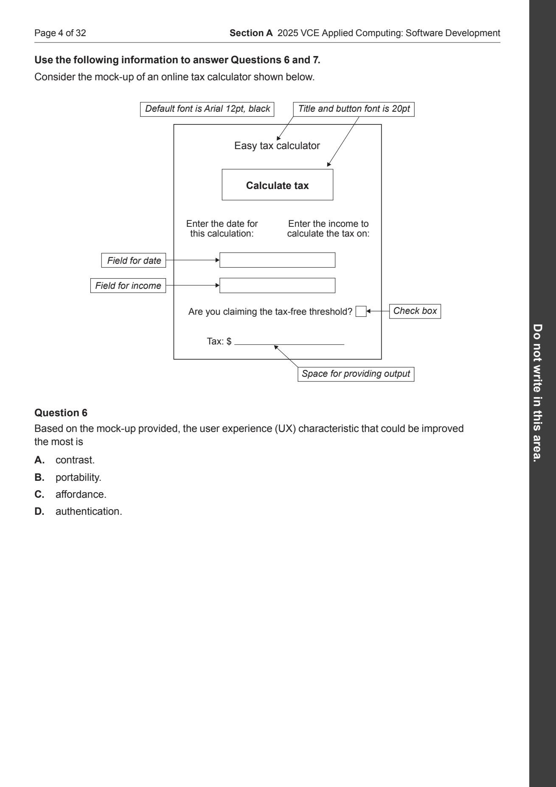
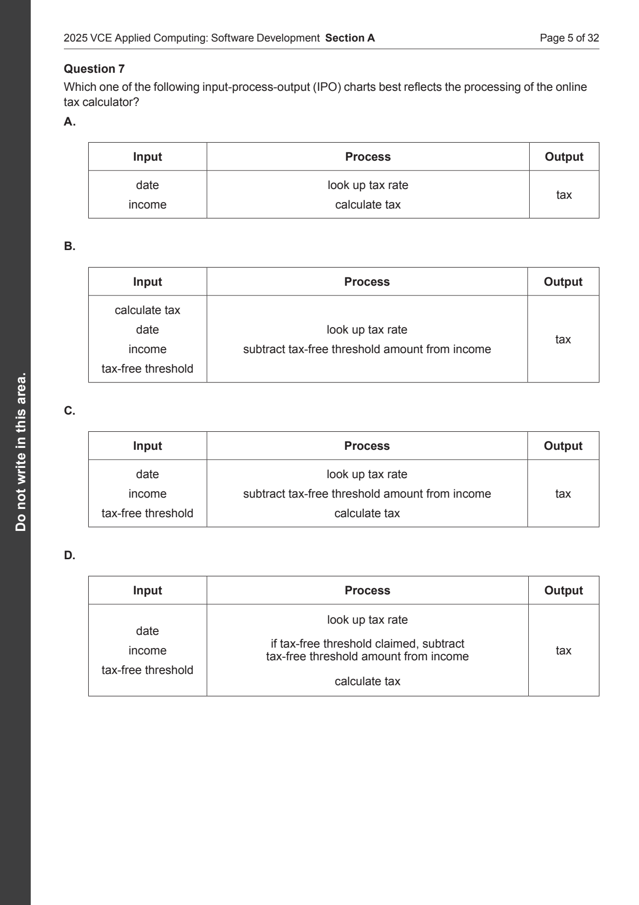
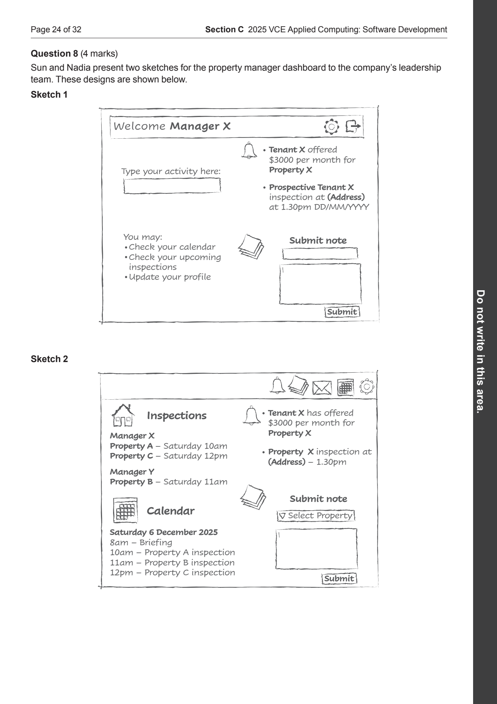
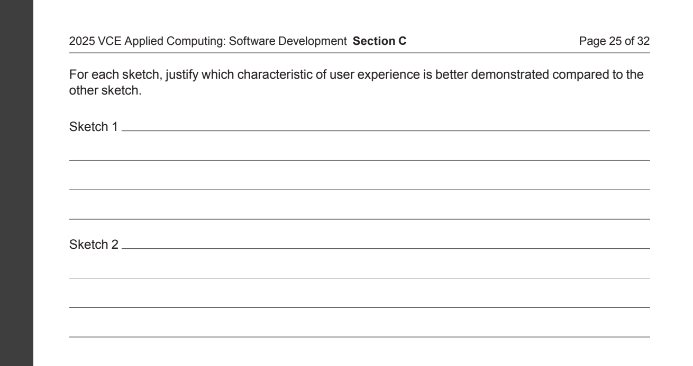
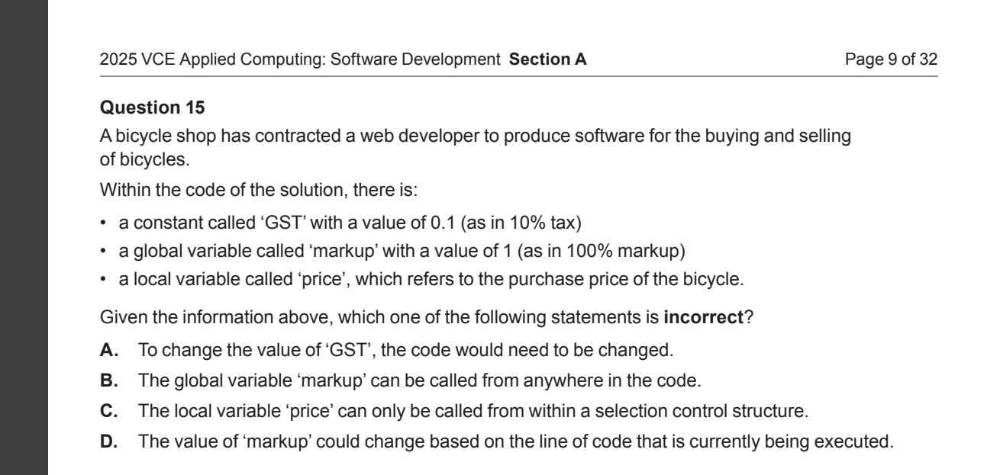
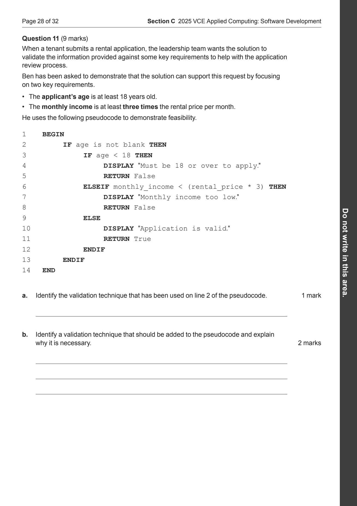
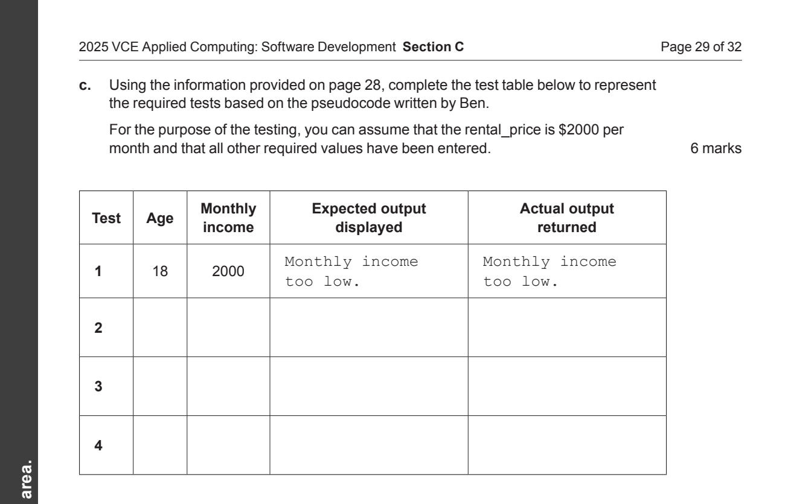

# Week 2 — Understanding graphical user interfaces

## Class Document

### 1. What a GUI does

**GUI** means **graphical user interface**. It is the part of a program that a person uses through visual elements such as windows, buttons, text fields and menus. You can use a mouse, touch or keyboard to interact with these elements.

Consider a ticket calculator. You enter the number of tickets, select whether you are a member, and press **Calculate total**. The program then shows a price.

There are two connected jobs:

| Part | Its job | In the ticket calculator |
|---|---|---|
| **Interface** | Let the person enter information, choose an action and read feedback. | A quantity field, a membership checkbox, a button and a result label. |
| **Processing logic** | Apply the rules to the information. | Choose the correct ticket price and multiply it by the quantity. |

A button drawn on a screen does not calculate anything by itself. We must connect it to instructions. Those instructions read the input, perform the calculation and change what the screen displays.

The examples use **Tkinter**, a Python library for creating desktop interfaces. The GUI concepts apply across programming languages; the Tkinter commands show one practical way to implement them. [Python documentation][tkinter]

### 2. Reading a screen and choosing its controls

Our example is a **club ticket calculator** with these rules:

- A standard ticket costs **$12**.
- A member ticket costs **$10**.
- The quantity must be a **whole number from 1 to 5, inclusive**. Inclusive means both 1 and 5 are allowed.
- The program calculates a quote when **Calculate total** is activated. It does not take payment or reserve tickets.


*Figure 1. Read the numbered screen parts alongside their jobs. The field and checkbox supply information; the button requests an action; the label displays feedback.*

A **widget** is one component of an interface. An interactive widget is often called a **control**.

| Screen part | What it means | What the program does with it |
|---|---|---|
| **Window** | The container holding the interface. | Creates it and keeps it open while the application runs. |
| **Label** | Text shown to the user. | Displays an instruction, a result or an error message. The user does not normally edit a label. |
| **Text field** | A space where the user types. Tkinter calls this an `Entry`. | Reads the text currently in the field. |
| **Button** | A control for requesting an action. | Runs connected instructions when activated. |
| **Checkbox** | An independent yes/no choice. | Reads whether it is selected or unselected. |
| **Radio-button group** | A set of related choices from which one can be selected. | Reads the selected option. |
| **Dropdown list** | A list of options that opens when activated. | Reads the selected item. A selection-only dropdown prevents typing an unlisted value. |


*Figure 2. Choose a control by asking what the user needs to provide or do.*

#### Why different controls suit different tasks

Use a **text field** for a name because the person needs to type their own text. Use a **checkbox** for membership because it is one independent yes/no choice. Several independent checkboxes can be selected together.

Use a **radio-button group** when the person must choose one visible option, such as Small, Medium or Large. The buttons must belong to the same group to enforce one selection. Use a **dropdown** when a longer list would take too much screen space, such as a list of venues.

The words beside a field explain its purpose; they do not enforce its rules. A field labelled “Number of tickets” can still contain `hello`. The program must check the value it reads.

#### Visible text and names in code

The user sees **Calculate total**. The Python program might refer to that button as `calculate_button`.

The caption explains the action to the user. The code name helps the programmer identify the widget. Use meaningful names such as `quantity_entry`, `member_var` and `result_label`. In these examples, underscores separate words: this naming style is called `snake_case`.

### 3. Events: how an action starts code

An **event** is something that happens while the application is running. Examples include activating a button, changing a selection or pressing a key.

A **callback**, also called an **event handler**, is a function connected to an event. It contains the instructions for the response.

In our calculator:

- **Event:** the user activates Calculate total.
- **Callback:** the function `on_calculate` runs.
- **Response:** it reads and checks the inputs, calculates a price and changes the result label.


*Figure 3. Follow the arrows clockwise. One click causes one callback call; finishing that call leaves the application ready for another action.*

#### The event loop

The **event loop** manages events and runs the connected responses. In Tkinter, this line starts it:

```python
window.mainloop()
```

Before this line, Python creates the window and its widgets. While the event loop is active, the application can respond to typing, button activation and other events. Clicking Calculate runs its callback; it does not restart the program from the first line.

The event loop also handles updating the window. If a callback performs a very long task without finishing, the window may appear frozen because other events and screen updates have to wait. Our small calculation finishes quickly.

#### Connect a function; do not call it during setup

```python
calculate_button = ttk.Button(
    window,
    text="Calculate total",
    command=on_calculate
)
```

Read `command=on_calculate` as: **“Use this function when the button is activated.”** The button stores a reference to the function so it can call it later.


*Figure 4. The round brackets `()` determine whether Python passes the function itself or calls it immediately.*

| Expression | What happens |
|---|---|
| `on_calculate` | Refers to the function. Its instructions do not run yet. |
| `on_calculate()` | Calls the function now. Its returned value is the value of this expression. |

In this example, `command=on_calculate()` would run the callback while the button is being created. It would pass the callback's returned value to `command`, rather than connect the intended function for later clicks. This can also fail if the widgets read by the callback have not been created yet.

### 4. Input, processing and output

**Input–process–output**, abbreviated to **IPO**, describes how information moves through a program.


*Figure 5. The membership value is part of the input. It changes which price the program uses during processing.*

| Stage | Meaning | Ticket example |
|---|---|---|
| **Input** | Information supplied to the program. | The quantity and membership choice. |
| **Processing** | Operations performed using that information. | Select a unit price, then multiply it by the quantity. |
| **Output** | Information produced by the program. | The displayed total or an input-error message. |

For three tickets, follow both possible choices:

| Membership input | Unit price selected | Calculation | Displayed total |
|---|---|---|---|
| `False` — checkbox unselected | 12 | `3 * 12 = 36` | `$36.00` |
| `True` — checkbox selected | 10 | `3 * 10 = 30` | `$30.00` |

`True` and `False` are **Boolean** values: a type with two possible values. The checkbox uses a Boolean to represent the membership choice.

The **button activation triggers processing**. The button's caption is not one of the ticket values used in the arithmetic. Selecting Member changes the membership input, but our design waits for Calculate before producing a new price.

When reading an IPO chart, follow the data: identify where each value comes from, how it changes the calculation, and what finally appears as output.

### 5. Reading and checking the input

#### A typed number starts as text

Suppose you type `3` into the quantity field:

```python
raw_quantity = quantity_entry.get()
```

`quantity_entry` refers to the field. `.get()` asks it for its current contents. The returned value is the **string** `"3"`, not the integer `3`.

The quotation marks show that a value is text in the explanation and code. They are not extra characters the user needs to type.


*Figure 6. This example uses three standard tickets: Member is `False`, so the price is $12 each. Read down the steps. Conversion prepares a number for arithmetic; formatting prepares text for the screen.*

Convert suitable text to an integer before using it as a ticket quantity:

```python
quantity = int(raw_quantity)
```

Types matter. `"3" * 2` repeats text and produces `"33"`. `3 * 2` multiplies numbers and produces `6`.

#### Validation: check the rules before calculating

**Validation** checks whether an input follows specified rules. For our quantity, use three checks in order:

1. **Existence:** has the user supplied a value?
2. **Type:** can the supplied text be converted to a whole number?
3. **Range:** is that number from 1 to 5, including both endpoints?


*Figure 7. Follow the Yes arrows to the calculation. A No arrow leads to feedback and an early return; the window remains open.*

**Step 1 — read the field and remove surrounding spaces.**

```python
raw_quantity = quantity_entry.get().strip()
```

`.strip()` removes whitespace from the beginning and end. `" 3 "` becomes `"3"`. A field containing only spaces becomes the empty string `""`.

**Step 2 — handle an empty field.**

```python
if raw_quantity == "":
    result_label.configure(text="Enter the number of tickets.")
    return
```

`.configure(text=...)` changes the label's text. `return` ends this callback call so Python does not continue to the conversion below. It does not close the application.

**Step 3 — attempt integer conversion safely.**

```python
try:
    quantity = int(raw_quantity)
except ValueError:
    result_label.configure(text="Enter a whole number.")
    return
```

`int("3")` succeeds. `int("three")` and `int("3.5")` fail with a `ValueError`. The `except` block handles that failure and shows a message. The program can then accept another attempt.

**Step 4 — check the permitted range.**

```python
if quantity < 1 or quantity > 5:
    result_label.configure(text="Enter a quantity from 1 to 5.")
    return
```

The condition rejects a number below the minimum **or** above the maximum. Values 1 and 5 pass because neither is outside the range.

| Field contents | What happens | Reason |
|---|---|---|
| Empty, or spaces only | Show “Enter the number of tickets.” | No value remains after stripping spaces. |
| `three` or `3.5` | Show “Enter a whole number.” | Integer conversion fails. |
| `0` or `6` | Show “Enter a quantity from 1 to 5.” | Conversion succeeds, but the number is outside the range. |
| `1`, `3` or `5` | Continue to the price calculation. | All three checks pass. |

Notice the difference between the checks: `6` has the right type but the wrong range. A successful conversion alone does not make it acceptable.

Validation cannot prove the user's intention. If the user meant two tickets but entered a valid `3`, these checks will accept it.

### 6. Connecting interface code to a calculation

A **function** is a named block of code that performs a task. A **method** is a function associated with an object. For example, `.get()` is a method used on the entry widget, and `.configure()` is a method used to change a widget's options.

Give the calculation and the callback clear, separate jobs.

#### The calculation function receives values and returns a number

```python
STANDARD_PRICE = 12
MEMBER_PRICE = 10

def calculate_total(quantity, is_member):
    unit_price = STANDARD_PRICE
    if is_member:
        unit_price = MEMBER_PRICE
    return quantity * unit_price
```

The **parameters** `quantity` and `is_member` are names for the inputs received by this function. In the call `calculate_total(3, False)`, the **arguments** are the supplied values `3` and `False`.

Follow that call: the unit price starts at 12; membership is false, so the price stays 12; the function returns `3 * 12`, which is `36`.

This function does not read the text field or change a label. It works with the values passed to it. This makes it possible to check the calculation separately from the screen.

#### The callback coordinates the response

After the validation steps, the callback does this:

```python
is_member = member_var.get()
total = calculate_total(quantity, is_member)
result_label.configure(text=f"Last calculated total: ${total:.2f}")
```

1. Read the checkbox's current Boolean value.
2. Pass the checked quantity and membership value to the calculation function.
3. Store the returned number in `total`.
4. Format it and change the visible label.


*Figure 8. With quantity `3` and membership `False`, the calculation returns `36` to the callback. The callback must still place display text in the label.*

#### Returning and displaying are different operations

`return 36` sends a value back to the code that called the function. It does not tell a label to show anything.

`result_label.configure(text="Last calculated total: $36.00")` changes the interface. It gives the label the text that should be visible.

The expression `f"${total:.2f}"` creates formatted text. The `$` is a visible currency symbol, and `.2f` displays two decimal places. When `total` is 36, the text is `$36.00`. Keep a numeric value for calculations; format it when preparing the display.

### 7. State: what changes, and when

**State** means the values the application currently holds. Our GUI's state includes:

- the text currently in the quantity field
- whether Member is selected
- the text currently shown in the result label.

These values do not all change at the same time.


*Figure 9. Compare the middle two screens carefully. The membership input changes immediately; the calculated output changes only after another Calculate action.*

Follow the actions one at a time:

| User action | What changes now | What is shown in the result label |
|---|---|---|
| Enter `3`; leave Member unselected. | The entry contains `"3"`. | `Last calculated total: --` |
| Activate Calculate. | The callback reads the inputs and produces a standard quote. | `Last calculated total: $36.00` |
| Select Member without activating Calculate. | Membership becomes `True`. | Still `Last calculated total: $36.00` |
| Activate Calculate again. | The callback reads the current inputs and produces a member quote. | `Last calculated total: $30.00` |
| Activate Calculate once more with unchanged inputs. | A fresh calculation gives the same result. | Still `Last calculated total: $30.00` |

There is no callback connected to membership changes that recalculates the total in this design. A program could recalculate automatically, but we would have to connect that response explicitly.

The words **Last calculated total** describe the result accurately. They signal that it belongs to the most recent calculation, which may have used earlier inputs.

#### Calculate a fresh quote on each click

For this calculator, use `total = quantity * unit_price`. Do not add the new quote to the previous quote. Three clicks requesting the same $30 quote should still show $30, not $90.

The callback must also read the fields **inside the callback**, on each click. If it read the quantity only during setup, later calculations could use an old value.

#### Local variables and values kept by widgets

`quantity` and `total` inside `on_calculate` are **local variables**. Their names belong to that function call. Another click starts a new call and reads the current controls again.

The widgets remain available while the window is open. Changing `result_label`'s text changes the widget, so the new text stays visible after the callback finishes.

In the full example, the widget names and price constants are defined at **module level**, outside the functions. The callback can use those names. Calling `result_label.configure(...)` changes the widget; it does not assign a different widget to the name `result_label`, so it does not require a `global` declaration.

`STANDARD_PRICE` and `MEMBER_PRICE` are treated as **constants**: values intended to remain unchanged. Uppercase names communicate that intention. Python does not enforce it merely because the names are uppercase.

### 8. Arranging a clear interface

**Layout** means the position, size and spacing of the interface's parts. A clear layout places related information together and makes the next action easy to find.

#### Place widgets using a grid

Tkinter's `.grid()` places widgets in rows and columns. Row and column numbers start at **0**.


*Figure 10. Read the row number from the left and the column number from above. This grid describes screen positions.*

```python
quantity_entry.grid(row=0, column=1, padx=12, pady=12)
```

This puts the field in the first row and second column. `padx=12` adds horizontal space around it; `pady=12` adds vertical space.

```python
result_label.grid(row=3, column=0, columnspan=2, sticky="w")
```

This places the label in the fourth row, beginning in the first column and spanning two columns. `sticky="w"` aligns it towards the west, or left, side of that space.

The layout grid is not a two-dimensional data array. It controls where widgets appear; it does not store the user's ticket data.

#### Use words that explain the task


*Figure 11. Compare matching numbers. Each wording change answers a question the user would otherwise have to guess.*

| Design choice | Why it helps |
|---|---|
| Put “Number of tickets (1–5)” beside the field. | The user can identify the input and its allowed range before entering it. |
| Label the button “Calculate total”. | The action is clearer than a caption such as “Go”. |
| Label the output “Last calculated total”. | The number has a clear meaning and is identified as a previous calculation. |
| Show “Enter a whole number” after unsuitable text. | The user knows what needs correcting. |
| Use readable text, space and aligned controls. | The user can scan the screen and associate each label with its control. |
| Explain errors in words as well as any colour change. | The message remains understandable when colour alone is difficult to distinguish. |

**User experience (UX)** concerns the person's experience of using software. These terms help describe different features:

| Term | Simple meaning | Example |
|---|---|---|
| **Affordance** | Features or cues suggesting how something can be used. | A recognisable button shape suggests that it can be activated. |
| **Usability** | How easily the person can understand and complete a task. | A clearly labelled form and helpful error feedback. |
| **Interoperability** | The ability to work or exchange information with other systems. | An application importing events from another calendar. |
| **Security** | Protection of data and control of access. | Only authorised staff can view confidential records. |

A **mock-up** is a representation of a planned interface. It can show layout, labels and visible controls. A sketch alone cannot prove that hidden security or data-exchange code works.

When explaining a design, connect a specific feature to its effect. For example: **“The permitted range is shown beside the quantity field, so the user can see which quantities are accepted before submitting.”** “It is user-friendly” is too vague to explain why a feature helps.

### 9. The complete ticket calculator

Save this program as `ticket_gui.py` and run it using Python with Tkinter and a desktop display. `python -m tkinter` opens a small demonstration window if Tkinter is installed correctly. [Installation check][tkinter]

```python
import tkinter as tk
from tkinter import ttk

STANDARD_PRICE = 12
MEMBER_PRICE = 10


def calculate_total(quantity, is_member):
    unit_price = STANDARD_PRICE
    if is_member:
        unit_price = MEMBER_PRICE
    return quantity * unit_price


def on_calculate():
    raw_quantity = quantity_entry.get().strip()

    if raw_quantity == "":
        result_label.configure(text="Enter the number of tickets.")
        return

    try:
        quantity = int(raw_quantity)
    except ValueError:
        result_label.configure(text="Enter a whole number.")
        return

    if quantity < 1 or quantity > 5:
        result_label.configure(text="Enter a quantity from 1 to 5.")
        return

    is_member = member_var.get()
    total = calculate_total(quantity, is_member)
    result_label.configure(
        text=f"Last calculated total: ${total:.2f}"
    )


window = tk.Tk()
window.title("Club ticket calculator")

ttk.Label(window, text="Number of tickets (1–5):").grid(
    row=0, column=0, padx=12, pady=12, sticky="w"
)
quantity_entry = ttk.Entry(window, width=10)
quantity_entry.grid(row=0, column=1, padx=12, pady=12)

member_var = tk.BooleanVar(value=False)
ttk.Checkbutton(
    window, text="Club member", variable=member_var
).grid(row=1, column=0, columnspan=2, padx=12, pady=6, sticky="w")

calculate_button = ttk.Button(
    window, text="Calculate total", command=on_calculate
)
calculate_button.grid(
    row=2, column=0, columnspan=2, padx=12, pady=12, sticky="w"
)

result_label = ttk.Label(window, text="Last calculated total: --")
result_label.grid(
    row=3, column=0, columnspan=2, padx=12, pady=12, sticky="w"
)

window.mainloop()
```

#### Read it in execution order

**Before any click:** Python imports the libraries, assigns the prices and defines the functions. A `def` statement creates a function; it does not run the function's body. Python then creates the window and widgets, connects the button's callback and starts the event loop.

**When Calculate is activated:** `on_calculate` reads the current field. Failed checks show a message and end the call. Successful checks lead to reading the current membership, calling `calculate_total` and updating the label. The callback then finishes, and the event loop can handle another action.

#### What connects the checkbox to a Boolean

```python
member_var = tk.BooleanVar(value=False)
```

This creates a Tkinter value initially set to `False`. The checkbox's `variable=member_var` option connects that value to the checkbox. Selecting the checkbox changes it to `True`; unselecting changes it to `False`. `member_var.get()` reads it.

The connection updates membership; it does not automatically call `on_calculate`.

### 10. Testing the interface and finding mistakes

**Testing** means comparing the behaviour a program should produce with what it actually produces. **Debugging** means finding and fixing the cause of a difference.

For a GUI, test both the data and the sequence of actions. A calculation can work for one click yet fail after an input changes.

| Test | Input and action | Expected response in this program |
|---|---|---|
| Normal valid input | Enter `3`, leave Member unselected, activate Calculate. | `Last calculated total: $36.00` |
| Lower valid boundary | Enter `1`, select Member, activate Calculate. | `Last calculated total: $10.00` |
| Upper valid boundary | Enter `5`, leave Member unselected, activate Calculate. | `Last calculated total: $60.00` |
| Just outside either limit | Enter `0`, then separately `6`, activating Calculate each time. | `Enter a quantity from 1 to 5.` |
| Missing input | Leave the field empty, or use only spaces, then activate Calculate. | `Enter the number of tickets.` |
| Unsuitable text | Enter `hello`, then separately `3.5`, activating Calculate each time. | `Enter a whole number.` |
| Change a choice | Calculate three standard tickets, select Member, then activate Calculate again. | `$36.00` remains until the new calculation; the new total is `$30.00`. |
| Repeat an action | Calculate the same three member tickets twice. | The total remains `$30.00`; it does not accumulate. |

**Boundary tests** use values at the allowed limits. Values just outside those limits test rejection. For a valid range of 1–5, test 1 and 5 as valid boundaries, then 0 and 6 as invalid neighbours.

To record a test, first write the inputs, actions and **expected result** from the requirements. Run the test, record the **actual result**, and compare them. Expected and actual are separate: an expected result is a prediction; an actual result is observed execution.

| Symptom | What to investigate |
|---|---|
| The button appears but does nothing visible. | Is a callback connected? Does it update a visible widget? |
| Calculation runs before the first click. | Was `on_calculate()` called when creating the button? |
| A function returns the right number, but the label stays unchanged. | Does the callback send the returned value to the label? |
| Empty input causes an exception. | Is conversion attempted before handling missing input? |
| A later click uses an earlier quantity. | Are the current inputs read inside the callback? |
| Each click increases the same quote. | Is the code adding to an old total instead of calculating a fresh one? |

Use the code and the action sequence to identify the cause. One visible symptom can have more than one cause.

### 11. Key words and reference sources

| Word | Meaning |
|---|---|
| GUI | The graphical interface through which a person uses a program. |
| Widget | One component of an interface. |
| Event | An action or occurrence the program can respond to. |
| Callback / event handler | A function connected to an event. |
| Event loop | The mechanism that manages events and their responses. |
| State | Values currently held by the application. |
| Validation | Checking input against specified rules. |
| Parameter / argument | A function's input name / a value supplied in a call. |
| Return value | A value sent back to the caller of a function. |
| Local variable | A variable whose name belongs to a function call. |
| Constant | A value intended to remain unchanged. |
| Mock-up | A representation of an interface's planned appearance. |

#### References

- [VCAA Applied Computing study design from 2025, version 1.2, June 2026][study] — the study design applicable to the 2027 course. Unit 3 Area of Study 1 covers GUIs and connected programming, validation and testing skills. At least two modules in its assessed module set must use GUIs. The ticket scenario and choice of Tkinter are teaching examples.
- [Official 2025 VCAA Software Development examination][exam] and [VCAA examination archive][archive] — sources of the real questions in the next part. The archive identifies the 2025 paper as relating to the current study design.
- [Python Tkinter documentation][tkinter] and [themed-widget documentation][ttk] — technical references for the implementation.
- [TkDocs first example][tkdocs] — an additional worked introduction to widgets and callbacks.
- [VCAA copyright policy][copyright] — terms and attribution for examination material.

The explanations, ticket program, learning diagrams and original practice questions were created for this guide. They are supplementary learning material, not official VCAA questions or predictions. Tkinter-specific practice is labelled as implementation practice in the Questions part.

[study]: https://vcaacorporateprod.prod.acquia-sites.com/sites/default/files/2026-06/2025AppliedComputingStudyDesign.docx
[tkinter]: https://docs.python.org/3.14/library/tkinter.html
[ttk]: https://docs.python.org/3.14/library/tkinter.ttk.html
[tkdocs]: https://tkdocs.com/tutorial/firstexample.html
[exam]: https://vcaacorporateprod.prod.acquia-sites.com/sites/default/files/2025-12/2025-AppliedComp-SoftwareDev.pdf
[archive]: https://www.vcaa.vic.edu.au/assessment/vce/examination-specifications-past-examinations-and-examination-reports/applied-computing-software-development
[copyright]: https://www.vcaa.vic.edu.au/footer/copyright


## Questions

### A. Real VCAA examination questions

**Source:** *2025 VCE Applied Computing Software Development examination*, 13 November 2025. The pages below are **printed booklet pages**, which also match the page positions in the linked official PDF for these extracts. The images preserve the question content; unrelated later questions are cropped out where indicated.

**Copyright acknowledgement:** © Victorian Curriculum and Assessment Authority. For current versions and related content visit [www.vcaa.vic.edu.au](https://www.vcaa.vic.edu.au).

#### R1 — Section A Question 6 — 1 mark

**Direct GUI question — Class sections 2 and 8.** Use the explanations of controls, labels and interface cues to interpret the mock-up. The UX terms help describe what a user can understand or do from visible features.

The shared tax-calculator mock-up and the complete question are below. Keep this mock-up available for R2 as well. [Official source, page 4](https://vcaacorporateprod.prod.acquia-sites.com/sites/default/files/2025-12/2025-AppliedComp-SoftwareDev.pdf#page=4).



#### R2 — Section A Question 7 — 1 mark

**Direct GUI-to-processing question — Class sections 4 and 6.** Trace the information supplied through the interface, the operations applied to it and the resulting output. Compare each proposed IPO chart with the mock-up’s controls and purpose.

Use the mock-up in R1. All four original IPO-chart alternatives are reproduced below. [Official source, page 5](https://vcaacorporateprod.prod.acquia-sites.com/sites/default/files/2025-12/2025-AppliedComp-SoftwareDev.pdf#page=5).



#### R3 — Section C Question 8 — 4 marks

**Direct GUI and UX question — Class section 8.** Connect visible design features to their effects on the user. Compare both sketches using the UX terms, distinguishing visible evidence from assumptions about hidden code.

The case concerns a rental-property-management web application. Both original dashboard sketches and the response prompt are provided. For the wider case, see the [original Insert](https://vcaacorporateprod.prod.acquia-sites.com/sites/default/files/2025-12/2025-AppliedComp-SoftwareDev.pdf#page=34). [Question source, pages 24–25](https://vcaacorporateprod.prod.acquia-sites.com/sites/default/files/2025-12/2025-AppliedComp-SoftwareDev.pdf#page=24).





#### R4 — Section A Question 15 — 1 mark

**Supporting programming question — Class section 7.** Apply the distinction between constants, local variables and names available across the program. The calculator illustrates the different roles of fixed prices and values read during a callback. The original stimulus is not a GUI; read its negative command carefully. [Official source, page 9](https://vcaacorporateprod.prod.acquia-sites.com/sites/default/files/2025-12/2025-AppliedComp-SoftwareDev.pdf#page=9).



#### R5 — Section C Question 11 parts a to c — 9 marks

**Supporting validation and testing question — Class sections 5, 6 and 10.** Use input validation, execution order and test-case design to trace the code. Distinguish text displayed on a screen from a value returned by a function. The original stimulus is pseudocode, not a GUI.

Read the complete requirements and numbered pseudocode before attempting the subparts. Part a is 1 mark, part b is 2 marks and part c is 6 marks. The original table headings and supplied example row are retained exactly as printed. [Official source, pages 28–29](https://vcaacorporateprod.prod.acquia-sites.com/sites/default/files/2025-12/2025-AppliedComp-SoftwareDev.pdf#page=28).





### B. Original practice questions

**These questions were written for this guide. They are not past VCAA questions and are not endorsed by VCAA.** The set contains 30 suggested practice marks: 8 multiple-choice marks, 10 short-answer marks and 12 case-study marks. It is a small practice set, not the official examination structure.

#### Practice Section A — Multiple choice — 8 marks

Choose one option for each question. Each question is worth 1 mark.

**P-A1 — Controls**

A library application lets a user enter a book title before selecting Search. Which control is most suitable for entering the title?

A. A label that displays the title of the application.  
B. An editable text field.  
C. A button labelled Search.  
D. An image of a book.

**P-A2 — Events**

A price calculator remains open after displaying a result. Which action is an event that could cause a connected callback to run?

A. A comment describing the calculation.  
B. The name chosen for a price constant.  
C. A diagram showing the interface.  
D. The user activating the Calculate button.

**P-A3 — Connecting a callback (Tkinter implementation practice)**

The function `show_result` should run when a button is activated. Which Tkinter configuration makes that connection?

A. `command=show_result`  
B. `command=show_result()`  
C. `text="show_result"`  
D. `state="show_result"`

**P-A4 — Reading a text field (Tkinter implementation practice)**

A user enters `4` in a Tkinter `Entry`. Before conversion, what does `entry.get()` return?

A. The Boolean value `True`.  
B. The floating-point value `4.0`.  
C. The string `"4"`.  
D. The integer `4`.

**P-A5 — A user choice and processing**

A delivery calculator has a distance field, an Express checkbox and a Calculate button. Express delivery adds a fixed fee to the calculated price. Which statement correctly describes the checkbox?

A. It is the final delivery-price output.  
B. Its selected value is an input that changes processing.  
C. Its caption performs the price calculation.  
D. It replaces the need to read the distance.

**P-A6 — Changing state**

A calculator reads input only when Calculate is activated. Its label currently shows “Last calculated total: $20.00”. The user changes an input but has not activated Calculate again. Which statement is necessarily true?

A. Every local variable from the previous callback is updated immediately.  
B. The application restarts from its first line.  
C. The previously displayed value is automatically recalculated.  
D. The input state has changed; another calculation has not yet been requested.

**P-A7 — Early return**

Consider this callback fragment:

```python
if raw_quantity == "":
    message_label.configure(text="Enter a quantity.")
    return

quantity = int(raw_quantity)
```

What is the purpose of `return` here?

A. It ends this callback call before the later conversion.  
B. It closes every window in the application.  
C. It converts the blank text to zero.  
D. It removes the callback from the button permanently.

**P-A8 — Interface explanations**

A form displays “Enter a whole number from 1 to 8” beside its quantity field. Which explanation best connects the design feature to a user effect?

A. It makes all entered information factually true.  
B. It guarantees that the program cannot raise an exception.  
C. It communicates the accepted input before the user submits it.  
D. It removes the need for input checking in code.

#### Practice Section B — Short answer — 10 marks

**P-B1 — Following an event — 4 marks**

A school canteen has a GUI that calculates the price of lunch orders. The user enters a quantity, selects whether a drink is included and activates Calculate. The calculation function returns a price, but the result label does not change.

a. Identify the event and describe the callback's role. **2 marks**  
b. Explain why returning a price does not automatically change the label, and describe the additional operation needed. **2 marks**

**P-B2 — Checking input — 3 marks**

A swimming-pool application accepts a whole-number quantity from 1 to 6 in a text field. A developer immediately executes `quantity = int(quantity_entry.get())` when Calculate is activated.

Explain how the callback should handle missing input, unsuitable text and values outside the permitted range before calculating. **3 marks**

**P-B3 — Choosing controls — 3 marks**

A workshop-registration interface must collect:

- the participant's name
- exactly one attendance choice from Morning, Afternoon and Full day
- whether the participant wants email reminders independently of the attendance choice.

For each item, identify a suitable control and give a reason for its suitability. **3 marks**

#### Practice Section C — Case study — 12 marks

**P-C1 — Community-room price calculator**

A community centre is developing a GUI that calculates a room-hire quote. Hiring the room costs **$8 per whole hour**. The permitted duration is **1 to 4 hours inclusive**. Selecting the Projector checkbox adds **one fixed $5 charge** to the quote.

The screen contains an Hours text field, a Projector checkbox, a Calculate quote button and a result label. `successful_calculations` is a stored count that should increase only when a valid quote is calculated. This application gives a quote; it does not confirm a booking.

```text
+----------------------------------------+
| Community room quote                   |
| Hours (1–4): [              ]          |
| [ ] Projector                          |
| [ Calculate quote ]                    |
| Last calculated quote: --              |
+----------------------------------------+
```

The developer proposes this callback pseudocode:

```text
1  successful_calculations ← successful_calculations + 1
2  hours ← INTEGER(hours_text)
3  IF hours < 1 OR hours > 4 THEN
4      DISPLAY "Choose 1 to 4 hours."
5      RETURN
6  ENDIF
7  total ← hours * 8
8  IF projector_selected THEN
9      total ← total + 5
10 ENDIF
11 DISPLAY total
```

Assume `INTEGER` fails if its text cannot be converted to an integer. `DISPLAY` updates the result label. Numeric totals are displayed as plain numbers, without a dollar sign or decimal formatting. The callback runs only when Calculate quote is activated.

a. Identify the two user-supplied data inputs to the calculation and the type each should have after preparation for processing. **2 marks**

b. Explain two problems that could occur when the Hours field is blank, considering both execution and stored state. **2 marks**

c. Describe how the order of checking, calculation and count updating should be changed so that rejected input is handled correctly. **2 marks**

d. The user has calculated a quote and then selects Projector without activating Calculate quote again. Explain what changes immediately and what may still show an earlier value. **2 marks**

e. Specify one valid boundary test and one invalid range test. Include the input, checkbox choice and exact expected displayed result or message for each test. **2 marks**

f. Propose one improvement to the interface's feedback and explain its effect on the person using the application. **2 marks**
