# GUI choices, records and complete user workflows

The previous lecture introduced the ticket calculator: creating controls, responding to Calculate, checking the quantity and displaying a total. We will now develop that application by adding choices and controlling what happens when inputs change.

We will then use an equipment-loan register to work with several records, edit one record at a time and save or reopen the data. Finally, we will connect the screens, investigate faults and apply the same ideas to a workshop-booking interface. Each part builds on the previous one: **controls hold values, actions change records, and complete workflows keep the screen and data consistent**. A workflow is a connected sequence of actions, such as adding a loan, editing it, saving the file and reopening it.

## Part 1 — Connecting controls and actions

### 1.1 Connect each input to the value it represents

We will keep the ticket prices familiar: standard tickets cost **$12** and member tickets cost **$10**. Add a session choice to identify when the tickets will be used. Morning and Afternoon have the same price. The quote includes the chosen session.

| Input | Allowed values | Starting value | Suitable control |
|---|---|---|---|
| Quantity | A whole number from 1 to 5, including both limits. | Empty. | Text field. |
| Ticket type | Standard or Member; one choice. | Standard. | Radio-button group. |
| Session | Morning or Afternoon. | Empty; a choice is required. | Selection-only dropdown. |

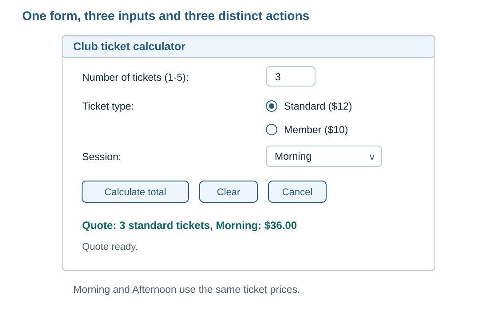

*Figure 1. A quote identifies the quantity, type and session used to produce it.*

Calculate checks the current inputs and produces a quote. Changing any input removes that quote until Calculate is activated again. Clear restores the starting inputs and instruction. Cancel closes this window.

This gives us a precise question for every action: **which stored values and visible messages should change?** For example, a Morning quote belongs to the Morning selection. Choosing Afternoon clears that quote so Calculate can produce a quote naming Afternoon.

A Tkinter **`StringVar`** holds text linked to a control. The field and that variable stay connected:

```text
User types 3 into the quantity field
                |
                v
Linked quantity value becomes "3"

Program writes "5" to the linked value
                |
                v
Quantity field displays 5
```

Trace these four instructions in the existing Tkinter window to follow field creation, reading and writing:

```python
quantity_var = tk.StringVar(master=window, value="")
quantity_entry = ttk.Entry(window, textvariable=quantity_var)
raw_quantity = quantity_var.get()
quantity_var.set("5")
```

`master=window` associates the value with this Tkinter application, and `value=""` starts with empty text. `textvariable` links the field to the variable. `.get()` reads its current text; `.set(...)` writes new text and updates the linked field. In this example, reading first gives empty text, and the final line makes the field display 5. A number typed into an Entry still needs conversion and checking before arithmetic.

Follow how these instructions affect the stored and displayed values:

| Situation | What happens |
|---|---|
| The program reads the field into `raw_quantity`, then the user changes the field. | `raw_quantity` keeps the earlier text. Read the input again on the next Calculate click. |
| The program calls `quantity_var.set("5")`. | The linked value becomes `"5"`, the field displays 5, and a later `.get()` reads `"5"`. |

A **callback**, or **event handler**, is a function that Tkinter calls in response to an action. For example, activating Calculate runs the calculation callback. Read inputs inside that callback so each calculation uses what the fields contain at the time of the click. A value read during window construction is a snapshot of the text at setup time. [Linked variables][widgets] [StringVar methods][stringvar]

### 1.2 Use controls that match the permitted choices

Standard and Member are alternatives within one input. Connect both radio buttons to one variable and give each button its own stored value:

```python
ticket_type_var = tk.StringVar(master=window, value="standard")
ttk.Radiobutton(window, text="Standard ($12)", variable=ticket_type_var, value="standard")
ttk.Radiobutton(window, text="Member ($10)", variable=ticket_type_var, value="member")
```

The caption is what the user reads. The `value` is what the program stores. Selecting Member stores `"member"`. The calculation uses that stored value to look up the $10 price.

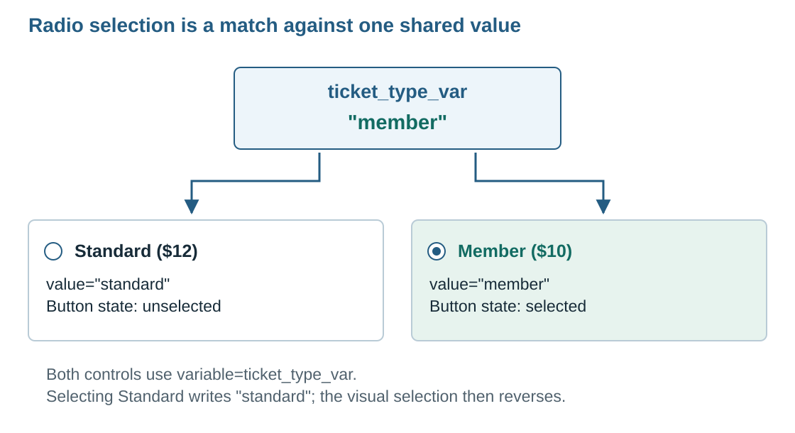

*Figure 2. The selected button is the one whose stored option matches the group's value.*

Follow one change:

1. Standard is initially selected because the shared value is `"standard"`.
2. The user selects Member, which writes `"member"` to that same variable.
3. The group displays Member as selected and Standard as unselected.
4. The calculation reads `"member"` and looks up the $10 price.

The shared variable creates the group and gives the form one current ticket-type value. To restore Standard, write `"standard"` to that variable. Both buttons then display the selection represented by the stored value.

Use a checkbox for an independent Boolean fact. In the register later in this guide, **Returned** is such a fact: it is either true or false, independent of which item was borrowed.

The ticket type is one choice; the session is a separate choice with its own stored value. For the session, use a dropdown, called a **Combobox** in Tkinter. Supply Morning and Afternoon as its options and use `state="readonly"`. The user changes the session by choosing Morning or Afternoon from the list. This readonly setting gives the field a selection-based input method.

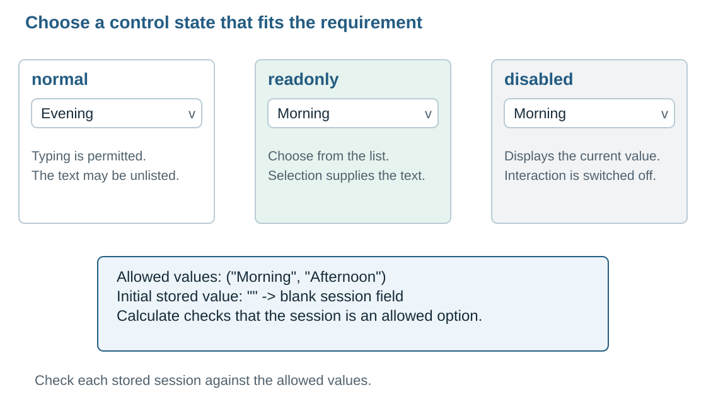

*Figure 3. The control state determines how the user supplies a value.*

| Dropdown state | User interaction |
|---|---|
| Normal | Can type text or choose a listed item. |
| Readonly | Changes the value through selection from the list. |
| Disabled | Displays the current value with user interaction switched off. |

The initial stored value controls the starting selection. An empty value gives a blank field, so Calculate asks the user to choose a session. Check membership in the allowed set as well: Python code can write a value such as `"Evening"`, and the application must identify that value during validation. [Combobox behaviour][combobox]

With two short choices, a second radio group would also be reasonable. A dropdown saves more space when the list is longer. Choose the control using the number of options, the meaning of the data and the space available on the form.

**Check the form:** select Member, then Standard. The selected marker should follow the current ticket type. Reopen the form, enter quantity `3`, leave the session field blank and activate Calculate. Expect the session instruction and `Quote: --`.

### 1.3 Keep calculations, input changes and reset actions consistent

The form's **state** consists of its current input values, quote and status message. A **state transition** is a change from one such set of values to another. Selecting Member changes the ticket-type value. Calculate reads the current inputs and updates the quote and status.

A quote describes one set of inputs. When an input changes, update the output state to show that a fresh quote is required. Follow this sequence:

| Action | Current inputs | Quote afterwards |
|---|---|---|
| Calculate. | 3, Standard, Morning. | `Quote: 3 standard tickets, Morning: $36.00` |
| Select Member. | 3, Member, Morning. | `Quote: --` |
| Calculate. | 3, Member, Morning. | `Quote: 3 member tickets, Morning: $30.00` |
| Choose Afternoon. | 3, Member, Afternoon. | `Quote: --` |

Use separate output labels for the quote and for instructions or errors. The status label can show `Quote ready.` or `Choose Morning or Afternoon.` while the quote label holds the quotation or its empty placeholder.

Tkinter can notify a function whenever an input variable is written. This notification is a **write trace**. Connecting the response to the variable is called registering the trace. Connect it to quantity, ticket type and session so each input requests the same quote-clearing response. Watching the stored variables covers typing, mouse selections and values written by the program.

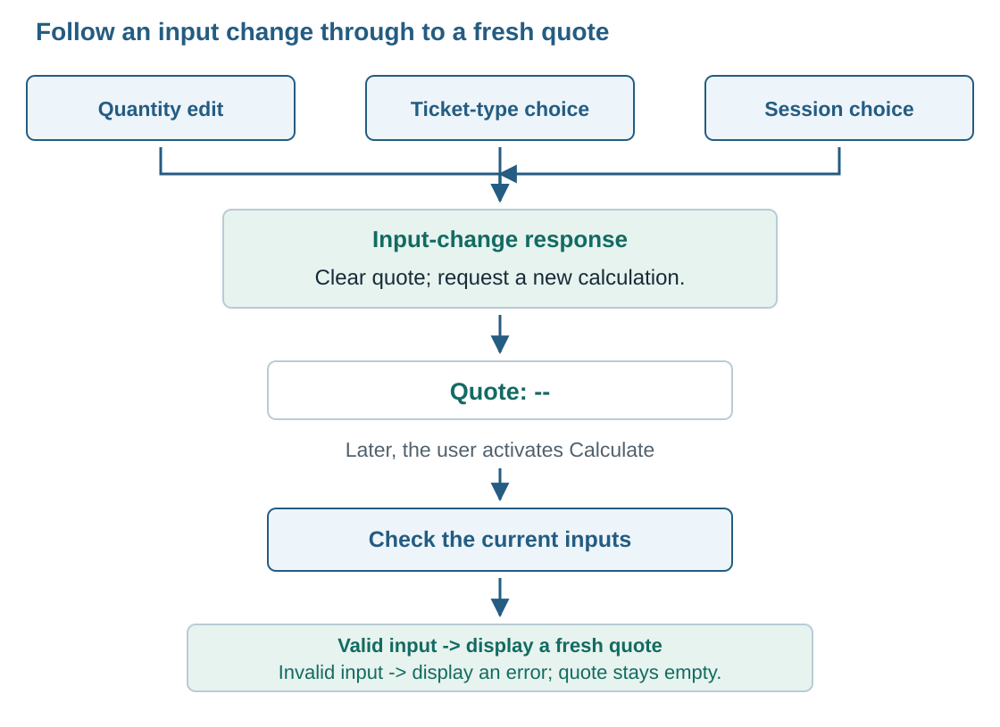

*Figure 4. An input change requests recalculation. The next Calculate action produces the replacement quote.*

This short example connects a quantity write to the input-change response:

```python
def on_inputs_changed(_name, _index, _operation):
    quote_var.set("Quote: --")
    status_var.set("Inputs changed. Calculate a new quote.")

quantity_var.trace_add("write", on_inputs_changed)
```

Register the same handler on the other two input variables. Tkinter supplies three arguments to this callback: the variable name, an element index and the operation. An argument is a value passed into a function when it is called. An element index identifies one part of a multi-value variable; our StringVar holds one text value, so that argument is empty. The operation is `"write"`.

The handler accepts the three details through `_name`, `_index` and `_operation`. The leading underscore is a naming convention for an intentionally unused parameter. The response itself consists of the two output assignments shown above. This parameter list matches the three values supplied by Tkinter.

Create the variables and define the handler before registering the traces. Attach the traces to the three inputs. The handler writes the quote and status outputs. [Watching linked values][widgets]

A write notification can occur when the program writes the same value again. Treat this as a request to clear the quote safely, even when the new text matches the old text.

The input-change handler removes a quote; the Calculate callback creates one. Calculate must read the inputs each time, check quantity and choices, and then replace the quote with a fresh result. Three Member tickets cost $30 on the first click and still cost $30 on the second. Each click assigns the newly calculated total.

If a check fails, leave the inputs available for correction, remove the quote and display a specific message. With blank quantity and session, report the first failed check. After quantity is corrected, a later click can report the missing session.

Clear prepares the form for another calculation. Every field and message must agree with the starting state, as shown below.

| Form component | Value after Clear |
|---|---|
| Quantity | Empty. |
| Ticket type | Standard. |
| Session | Empty. |
| Quote | `Quote: --` |
| Status | `Enter 1 to 5 tickets and choose a session.` |
| Window and keyboard focus | Keep the window open and request focus for quantity. |

**Keyboard focus** identifies the control that receives keyboard input. Returning focus to quantity means the next typed number goes into that field when the application window is active. Include the focus request as the final step of the Clear action.

Clear writes the input values, so their write traces also run. Each trace can temporarily write `Inputs changed. Calculate a new quote.` Therefore restore the final starting instruction **after** the input resets.

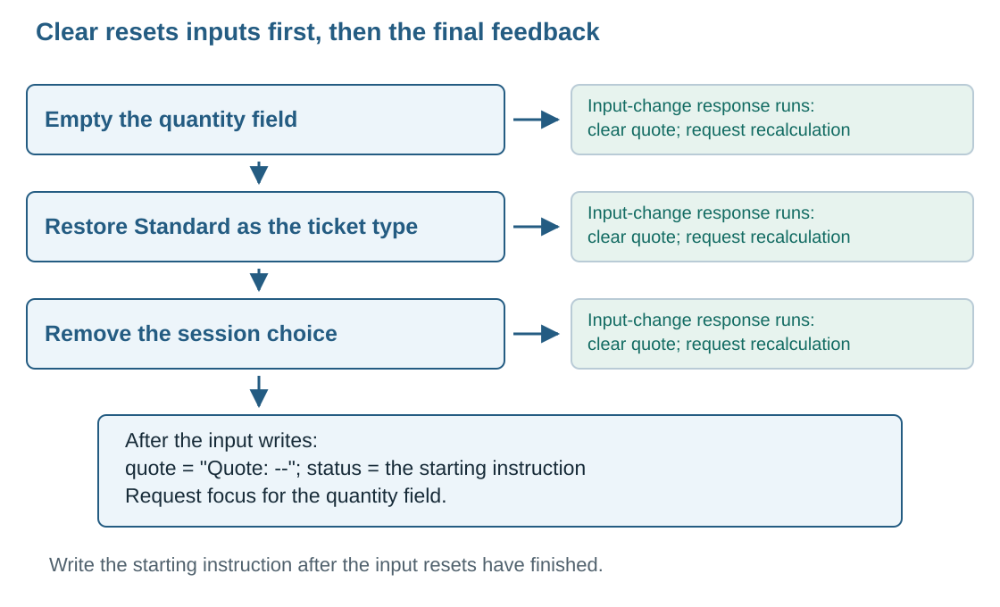

*Figure 5. The order matters because resetting an input can trigger another callback.*

```text
Clear begins
   -> empty quantity          -> input-change handler runs
   -> select Standard         -> input-change handler runs
   -> empty session           -> input-change handler runs
   -> set Quote: --
   -> set the starting instruction
   -> request quantity focus
Clear finishes
```

Those callbacks run during the input writes. Tkinter draws the resulting screen as the event loop processes display updates. Check the values and feedback after the complete Clear action finishes.

Clear must work after a valid quote, after an error and twice in a row. Each Clear action finishes with the complete starting state.

Cancel closes this one-window calculator. In Tkinter, the closing operation is `window.destroy()`. Use `return` when the current callback has finished its response and the application should continue waiting for another action.

The meaning of Cancel depends on the task. Here it closes the calculator. In Part 2 we will also use Cancel to dismiss a file-choice window and keep the application open. Connect each Cancel action to the outcome required by its window or task.

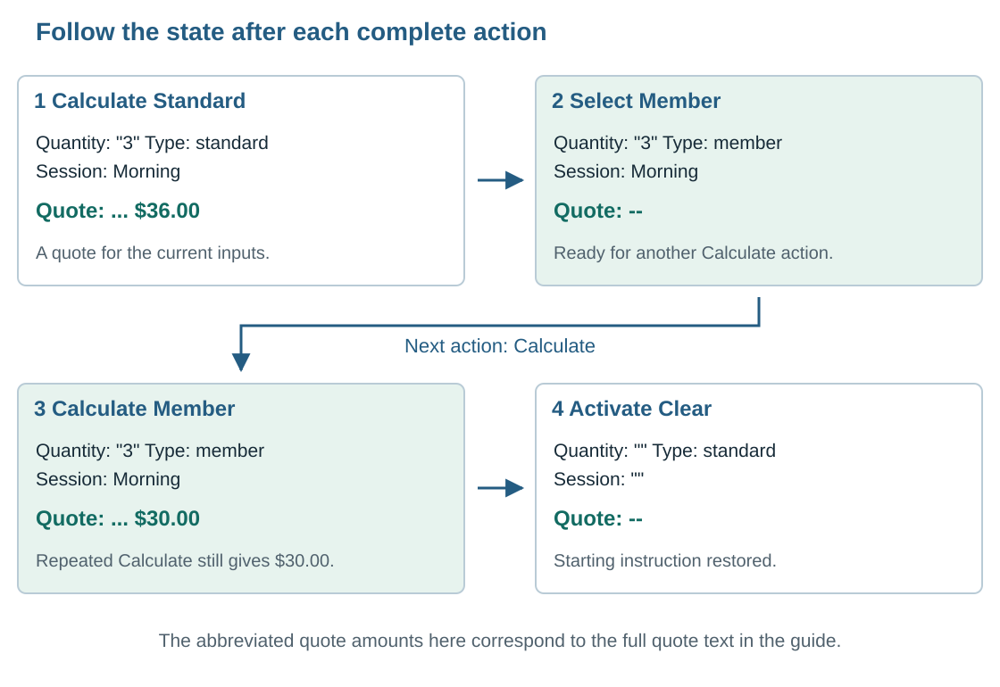

*Figure 6. Follow the complete action and inspect the resulting state.*

| Sequence | Expected behaviour |
|---|---|
| Enter 3, choose Morning, select Member, Calculate twice. | Each Calculate action displays the same $30 quote. |
| Start with a valid quote, change only the session, then Calculate. | The old quote disappears; the new quote names the chosen session. |
| Start with a valid quote, replace quantity with `hello`, then Calculate. | The edit clears the quote. Calculate shows `Enter a whole number.` The field still contains `hello`. |
| Produce an error, then Clear twice. | Each Clear finishes with the specified starting state. |

Write an **action trace** by recording inputs, callback, quote, status and window state after each action. This is your record of what happened; the earlier write trace is Tkinter's automatic notification mechanism. The action trace records the sequence for inspection, and the write trace runs the connected response during execution.

If changing the session leaves a Morning quote visible, inspect whether the session variable is connected to the input-change response. If Clear leaves the changed-input message, inspect reset order. These observations connect a visible fault to the specific value or callback that should have changed.

The accompanying `ticket_choices_gui.py` provides a runnable reference for the ticket calculator. Use the record and booking examples below to develop the next applications.

## Part 2 — Working with records and files

The calculator holds values for one quote. A register must keep several complete sets of values and let the user choose which one to change. We will keep the same rule that the screen must match the data, while extending it to selection, editing and saved files.

### 2.1 Display records and identify the selected record

An equipment-loan register stores one **record** for each loan. A record groups related, named values called **fields**: the item, borrower and quantity are fields of one loan. The accepted records held by the running application form its **working collection**, also called its dataset. Accepted means the values have passed the application's checks and have been added to that collection.

The list screen helps you locate a loan; the detail area shows the fields belonging to the selected loan. The working collection holds the record, and the displayed row gives the user a way to find and select it.

Use these sample loans throughout the worked examples:

| Loan ID | Item | Borrower | Quantity | Due at | Returned |
|---|---|---|---|---|---|
| L101 | Camera | Mai | 1 | 2027-03-18 15:30 | No |
| L102 | Mic | Noah | 2 | 2027-03-19 09:00 | No |
| L103 | Camera | Ava | 1 | 2027-03-18 11:00 | Yes |

Two records can have the same item name. The two Camera rows belong to separate loans. Each loan therefore needs a **unique ID**, an identifying value assigned to exactly one record in the collection. The ID is **stable**: it stays with that loan when you edit its borrower or move its displayed row. Keep a **mapping**, meaning a connection between each displayed row and its record ID, so selecting the row can locate the right data.

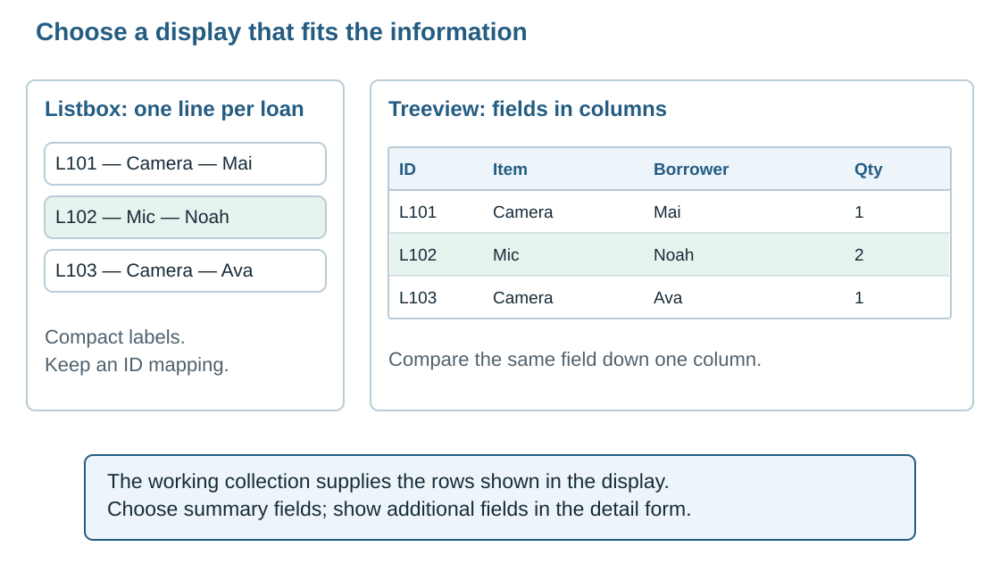

*Figure 7. A Treeview makes several fields easier to compare. A Listbox is suitable when one short label is enough.*

A **Listbox** displays a sequence of items, usually one text label per line. A **Treeview** can display each record across labelled columns. Here we use a table-style Treeview with one row per loan. A scrollbar should allow access to records outside the visible area. [Record display controls][tree]

Choose summary columns that help users locate and compare loans. Put additional fields in the details view, where the form has space to show each value clearly.

The register uses the small **catalogue** below: a list of permitted equipment and its fixed properties. Selecting an item supplies its category and mass, which appear as read-only information in the form. For example, choosing Mic fills the category with A and the mass with 0.35 kg.

| Item choice | Category code | Mass per item |
|---|---|---|
| Camera | V — Visual | 0.80 kg |
| Mic | A — Audio | 0.35 kg |
| Tripod | V — Visual | 1.20 kg |

Each field has a **data type**, meaning the kind of value it represents. Quantity is an integer because it counts whole items; mass uses floating point because it can include a fractional value such as 0.35. Returned is Boolean because it has two possible meanings, true and false. The type describes the information, while the control describes how the user supplies or sees it.

| Field | Example | Data type and rule | GUI representation |
|---|---|---|---|
| Loan ID | `L102` | String; unique and unchanged during edits. | Read-only label. Generated for a new accepted loan. |
| Item | `Mic` | String; must be a catalogue item. | Selection-only dropdown. |
| Borrower | `Noah` | String; must contain non-space text. | Text field. |
| Quantity | `2` | Integer; 1–5 inclusive. | Text field, converted and checked when submitted. |
| Due at | `2027-03-19 09:00` | Date/time; must be a real date and time in the stated format. | Labelled date/time field. |
| Category code | `A` | Character; one of A or V. | Read-only value supplied by the item choice. |
| Mass per item | `0.35` | Floating point; positive catalogue value, measured in kilograms. | Read-only value labelled with its unit. |
| Returned | `False` | Boolean; true or false. | Checkbox. New loans start unreturned. |

A character is one character, such as `A`. A string can contain several, such as `Mic`. Python represents both using `str`; a character field also needs a one-character rule.

The due value has date/time meaning. February 2027 has 28 days, so `2027-02-30 09:00` fails the calendar check. The program checks both the written format and the actual date. When saving it to a text file, the program writes a formatted date/time string. When loading it, the file function must check the real date and time and convert it to the representation used by the application.

An **array** provides another way to organise data. An array organises values by numbered positions. A one-dimensional array needs one position to locate a value; a two-dimensional array needs a row and a column. A record groups named fields about one thing. Each field has the type that fits its meaning.

```text
ONE RECORD — one loan, several named fields
L102: item=Mic, borrower=Noah, quantity=2, returned=False

ONE-DIMENSIONAL ARRAY — values addressed by one position
quantities: [1] [2] [1]
position:    0   1   2

TWO-DIMENSIONAL ARRAY — values addressed by row and column
                 column 0   column 1
row 0                1          2
row 1                3          4
```

The diagram shows how to locate a value in each structure: use a field name for a record, one position for a one-dimensional array, and a row plus column for a two-dimensional array. A GUI table can display values from any of these arrangements. Inspect the code that supplies its rows to identify the underlying data structure. Python lists support collections containing records or values of several types.

Now connect the record structure to selection. **Refreshing** a table means updating or rebuilding its displayed rows from the working collection. A row's position can change during that process or when the records are shown in a different order. Its loan ID must continue to refer to the same loan.

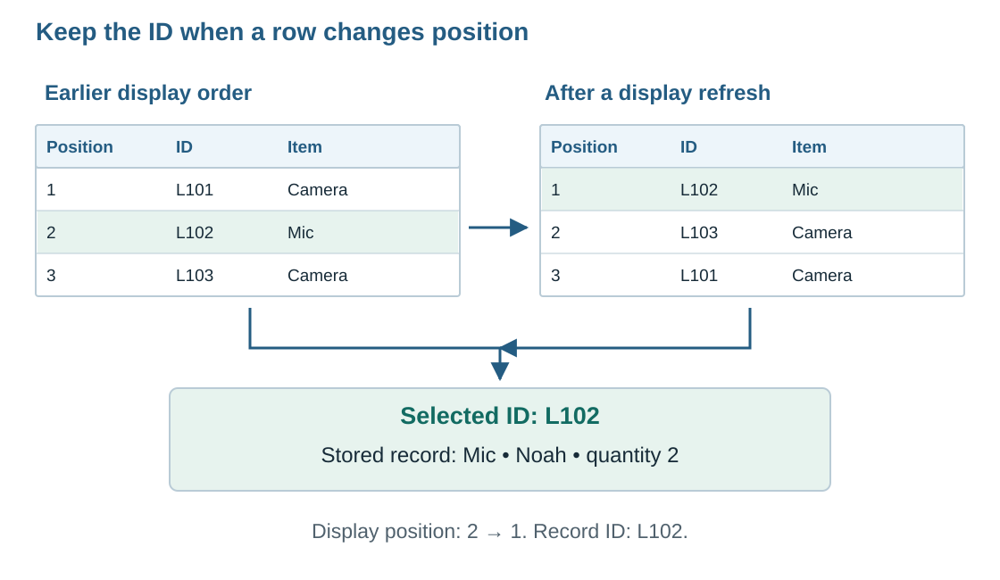

*Figure 8. Position tells you where the row appears. The ID tells you which record it represents.*

Suppose the second visible row is L102. After a display refresh, L102 becomes the first row. Reading the selected ID L102 lets Edit locate Noah's Mic loan in either display order.

Use this selection path:

```text
Selected visible row
        |
        v
Read its stable ID: L102
        |
        v
Find the stored record whose ID is L102
        |
        v
Fill the detail fields from that record
```

Treeview can use the record ID as its internal item identifier, called an **`iid`**. The following insertion assigns L102 as the row's internal ID. The selection call then retrieves the IDs selected in the table.

```python
loan_table.insert("", "end", iid="L102", values=("Mic", "Noah", 2))
selected_ids = loan_table.selection()
if selected_ids:
    selected_id = selected_ids[0]
```

Configure the table for one selected row in this application. `selection()` returns a collection of selected IDs. The `if selected_ids` check allows the handler to read the first ID when that collection contains a selection. An empty collection gives the handler a reason to request a selection. [Treeview identifiers and selection][ttk]

Set the internal `iid` when inserting the row, and include the ID in the displayed columns when it should be visible. These settings give the row its program identifier and its on-screen label.

Use the loan ID as the lookup **key**, the value used to find the intended record. The two Camera loans share an item name and have their own loan IDs. Their IDs give the lookup a precise target.

| Situation | Required response |
|---|---|
| Selection empty | Show Edit selected in its disabled state. Its handler requests a selection when called with an empty selection. |
| One valid selection | Store the selected ID and display that record's values. |
| Table refresh | Restore selection by ID if that record still exists. |
| Open replaces the entire dataset | Clear the old selection and detail display as the newly loaded collection becomes active. |

For a Listbox, keep a matching list of record IDs in the **same order as the displayed labels**. Its selected position is used to read the corresponding ID from that list. Rebuild both together when the displayed order changes.

Try this with the three sample loans: select L102 and show its details, then change the display order and select L102 again. Check that it still opens Noah's Mic loan. The row's ID provides the connection to its record through each display refresh. You should also be able to explain why the list screen can show fewer fields than the complete stored record.

### 2.2 Add and edit records through a separate draft

Once selection finds the correct record, we need a safe way to change it. A **draft** is a separate set of values currently being entered or edited. For example, opening L102 copies its accepted quantity 2 into the quantity field. Typing 9 changes the draft field, while the accepted record must remain at 2 until a valid edit is applied.

The form also needs to know its **mode**: whether it is adding a new loan or editing an existing one. Add mode waits for a newly generated ID. Edit mode keeps the ID of the record being changed, such as L102. The fields serve the current mode: Add accepts a new record, and Apply changes updates the fixed edit target.

Connect this to the calculator's input-change response. There, changing an input removed a derived quote. Here, changing a draft must leave the accepted record alone. An automatic response, such as filling the category and mass after an item choice, updates the draft display. Add loan or Apply changes accepts the draft after validation. The event response follows the purpose of each action in this form.

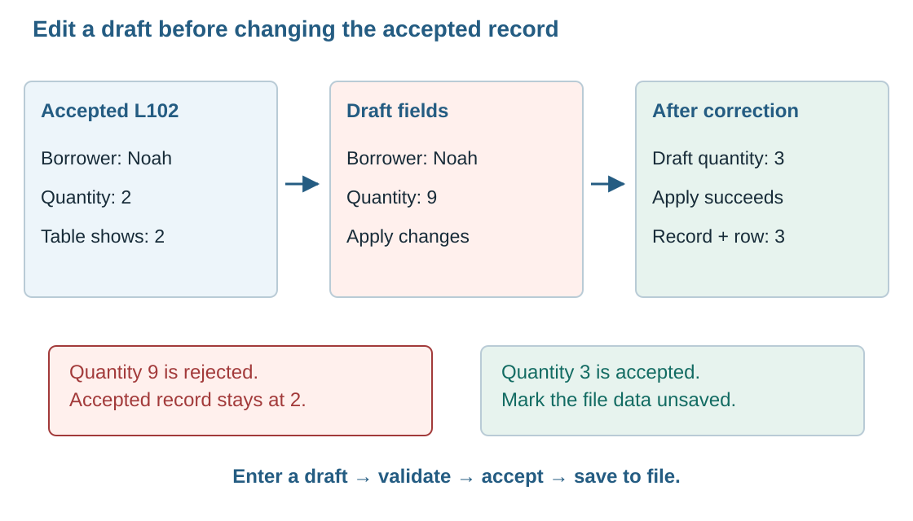

*Figure 9. Validation produces accepted values for the working records and displayed table.*

New loan opens an empty draft whose ID will be assigned on acceptance. Choose an item, enter a borrower, quantity and due time, and leave Returned unchecked for a new loan. Category and mass follow the item choice.

Use **Add loan** to submit this draft. Use **Save file** when you are ready to write the accepted collection to disk.

| Step | What the GUI or processing does | What must remain true |
|---|---|---|
| Start New loan. | Show an empty draft and default Returned to false. | Existing records remain unchanged. |
| Enter values. | Update draft fields and show category and mass for the chosen item. | The values remain in the draft until submission. |
| Activate Add loan. | Read and check all required values. | A complete, valid draft is ready for acceptance. A draft needing correction stays in the form. |
| Accept a valid draft. | Obtain a new unused ID and add one complete record. | The new ID is unique, including after loading a file. |
| Refresh the list. | Show and select the new ID. Report `Loan L104 added. Unsaved changes.` | The display matches the working collection. |

An **ID generator** is a function that chooses a unique identifying value for a new record. It uses the existing IDs to find an available value. With L101, L102 and L103 already present, the next value in our example is L104. The generator must check the current collection, including records loaded from a file, before accepting the new ID.

Enter Tripod, borrower Linh, quantity `2`, due at `2027-03-20 12:00`, Returned false. The category is V and mass per item is 1.20 kg. Add loan accepts the draft as L104.

After success:

- The working collection has four loans, including L104.
- The table includes L104 and selects it.
- The accepted record stores quantity as integer 2 and Returned as Boolean false.
- The file keeps its previous saved contents until Save file succeeds.

As a separate rejection test, start again with the original three loans and enter quantity `0`. Show `Enter a quantity from 1 to 5.` near the form, keep the entered draft for correction and leave the collection at three loans. The correction message stays visible beside the draft so the user can adjust the quantity and submit it again.

After a successful Add loan, display the accepted record and finish Add mode. A repeated activation then keeps that accepted record displayed. New loan starts a fresh draft for the next addition.

The form's mode controls this action. Enable Add loan during Add mode, and have its handler confirm that a new draft is ready for submission.

Editing starts with a selected ID. Copy that record's values into a draft and keep its ID fixed for the duration of the edit.

```text
Select L102 -> open an edit draft for L102
                   |
                   v
         Draft quantity: 9 or 3
                   |
                   v
             Apply changes
                   |
          +--------+---------+
          |                  |
       Invalid              Valid
          |                  |
 Keep stored L102       Update stored L102
 unchanged              Refresh row L102
 Keep draft for         Keep ID L102 selected
 correction             Mark file unsaved
```

Use **Apply changes** to accept an edit. It writes the accepted field values to the record identified by the fixed edit target.

For the worked example, start with Noah's accepted quantity at 2. Enter `9` in the draft and activate Apply changes. Show the range instruction. The working record and table must still show 2, while the draft retains 9 for correction. All the draft checks finish before any field is copied into the accepted record.

Now correct the draft to `3` and apply it. Both the working record L102 and its table row must show 3. L101 and L103 keep their original field values. This edit keeps the original collection at three loans.

Now consider a selection change during an edit. You are editing L102, type a different borrower name, and then select L101 in the table. If the table and edit area are visible together, the program must resolve the current draft before loading another record. Offer these choices:

| Choice | Result |
|---|---|
| Keep editing | Keep the current draft and its target ID; restore that row's selection. |
| Discard edits | Drop the draft, then load the newly selected record. Accepted records are unchanged. |

Keep the draft connected to its target ID through selection changes. Part 3 arranges the list and detail form in their own views. The same rule still applies: an edit belongs to one fixed record ID until it is applied or discarded.

Use code names that show each role, such as `selected_loan_id`, `draft_quantity` and `refresh_loan_table`. Use internal comments to explain a reason or a decision, for example: “Keep the edit target ID while the table is refreshed.” This tells the reader why the ID is retained through the refresh.

Check both the stored record and its visible row after each Add or Edit action. Check the reported ID and field values against the intended edit. Repeat Apply with the same values: the record count, accepted values and saved/unsaved status should all stay the same.

### 2.3 Save, reopen and preserve valid records

Applying a valid draft updates the running application's working collection. That collection is held in memory while the program runs. To keep the work after closing the program, write a copy to a file. The draft, working records, table display and saved file therefore have different roles, even when they show similar values.

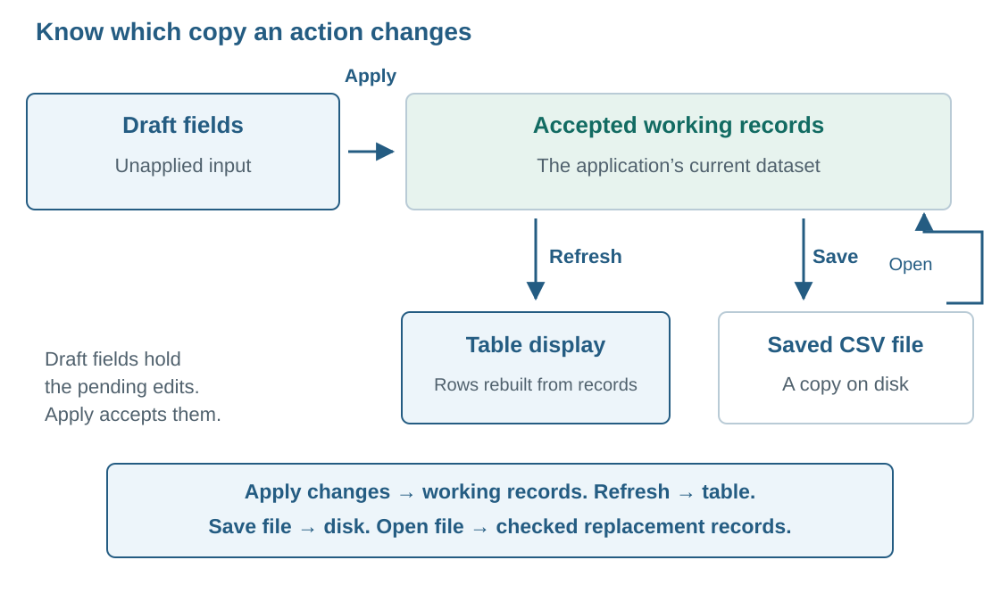

*Figure 10. Follow the draft into the working collection, then follow Save into the file.*

A status such as `Unsaved changes` means the accepted working collection has changed since its last successful save or load. The draft remains available for correction until Add loan or Apply changes accepts it. For example, typing quantity 3 creates a changed draft; Apply changes accepts 3 into the collection; Save file writes that accepted 3 to storage.

A **file path** identifies the location and name of a file. The current file path is the location associated with the last successful Open or Save. The first successful save gives a new collection its associated file path. A **dialog** is a small secondary window that asks for a choice, such as which file to open. Dismissing a file dialog leaves the main register open.

The GUI calls file-handling functions to do the reading and writing. For this register, use the following **contract**, meaning the agreement about their inputs and results:

| Function | Information it receives | Result the GUI can rely on |
|---|---|---|
| Reader | The chosen file path. | A complete, checked collection on success, or a message identifying the reading or validation error. The GUI decides when to make the returned collection active. |
| Writer | The chosen file path and accepted working records. | Confirmation of a successful write, or a message identifying the writing error. |

This division lets the GUI manage choices and feedback while the file functions handle the file contents. The callback must still decide whether to keep the current work, display an error or accept the returned records.

Use a save dialog to choose a filename. The file-writing function receives the chosen path and the accepted records.

| Outcome | Required screen and data behaviour |
|---|---|
| User cancels the save dialog | Keep the application open. Keep working data, current file path and unsaved state. Return control to the register with its existing status. |
| Writing succeeds | Keep the records; update the current path; mark accepted data saved; show `Saved 3 loans to loans.csv.` when three were written. |
| Writing fails | Keep working records and the previous file path; retain the current saved/unsaved status. Report that saving failed and allow another location or retry. |

The dialog supplies a file location. The writer then attempts to store the records there. Its success result is the signal to update saved feedback. When opening a file, the reader checks its contents against the agreed format and field rules.

An unfinished draft should be applied or discarded before a file action. In the two-view version, keep Open file and Save file on the list view so this distinction stays visible.

Open means **replace the current collection with the file's valid records** in this exercise. The returned records become the new working collection. Read into a **temporary collection**, a separate candidate set used for checking, so the current working records remain untouched until the new set passes.

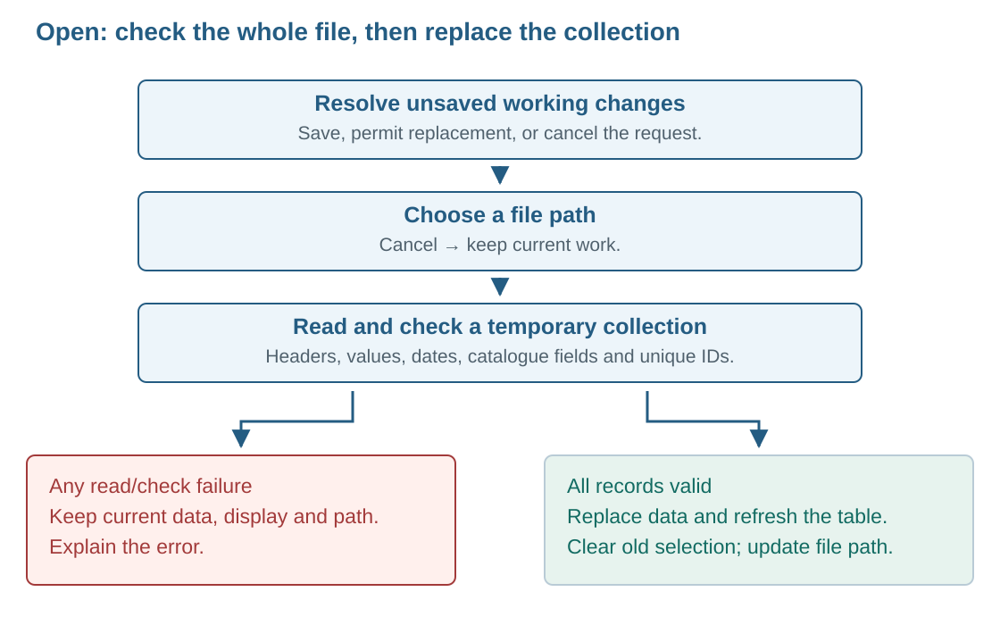

*Figure 11. The current collection stays available while the reader checks a candidate file.*

Follow this order:

1. If the working collection has unsaved changes, offer Save file, Discard changes or Cancel. Stop the Open request if Cancel is chosen or a requested save is cancelled or fails. Discard changes permits replacement once a valid new file is ready. Keep the current collection available throughout reading and checking.
2. Ask for the file path. If the dialog is cancelled, return to the current working collection.
3. Ask the reader to load into a **temporary collection**. Check the header, field values and unique IDs there.
4. If reading or checking fails, show a useful error. Keep the current collection, table, selection and file path.
5. If the whole file is valid, replace the working collection in one step. Refresh the table, clear the previous selection and detail display, update the file path, and mark the loaded data saved.

Keep the current table visible while the reader checks the candidate records. Refresh it from the new working collection after the whole file passes validation.

A cancelled filename dialog normally returns empty text for the path. Check for a missing path before calling the file-reading or file-writing function. Native dialogs may look different on different systems; the required cancellation behaviour remains the same. [Python file dialogs][dialogs]

The file also needs a defined format. **CSV** means **comma-separated values**. Each row below describes one loan, and the first row is a **header** naming the fields. Commas separate the fields; every loan uses the same structure.

```csv
loan_id,item,borrower,quantity,due_at,category_code,mass_kg,returned
L101,Camera,Mai,1,2027-03-18 15:30,V,0.80,false
L102,Mic,Noah,2,2027-03-19 09:00,A,0.35,false
L103,Camera,Ava,1,2027-03-18 11:00,V,0.80,true
```

Reading CSV normally supplies strings. The reader converts quantity to integer, mass to floating point and due time to the chosen date/time representation. Convert each allowed Boolean spelling explicitly: `"true"` becomes Boolean true, and `"false"` becomes Boolean false. This preserves the meaning of Returned during loading.

Use a CSV library to handle separators and quoted fields. A separator is also called a **delimiter**; here it is the comma. A borrower such as `Nguyen, Mai` needs quotation marks around the field so the comma remains part of the name. The CSV reader uses the quotation marks to keep that whole name in one borrower field. [Python CSV handling][csv]

Before accepting an imported file, check that:

- The required header and fields are present.
- Every ID is non-empty and unique within the imported collection.
- Quantity, date/time and Returned values obey the agreed rules.
- The item belongs to the catalogue, and its category and mass match the catalogue values.

Checking format and allowed values is **validation**. Comparing a displayed borrower's name with the original approved loan request is **verification** of the source information. Verification checks that the name agrees with the person identified in the source request.

CSV works well here because each loan has the same flat set of fields. To understand the choice, compare it with **XML**, or **Extensible Markup Language**. XML uses named tags to mark **elements**, which are pieces of structured information. Elements can contain other elements. The same loan could be written like this:

```xml
<loan id="L102">
  <borrower>Noah</borrower>
  <item name="Mic" category="A" mass_kg="0.35" />
  <quantity>2</quantity>
  <due_at>2027-03-19 09:00</due_at>
  <returned>false</returned>
</loan>
```

The outer `loan` element contains the borrower, item, quantity, due time and returned elements. The `id="L102"` text is an **attribute**: a named value written inside an element's opening tag. The item element also has attributes for its name, category and mass. These labels tell the reader what the values describe.

A larger design could put several item elements inside one loan. That is a **one-to-many relationship**: one loan contains several item details. CSV would need a different agreed arrangement to express it, such as repeated loan IDs across item rows or separate related files. That would be a different file structure from our current CSV, which requires one unique loan ID per row. XML describes that nesting through its element structure.

Our current register has one item type per loan, so its flat, repeated structure fits CSV well. Use the CSV reader and writer to implement the register's file actions.

A **round trip** means writing the working records to a file, reading them back and checking that their meanings are preserved.

| Test | Action | Expected result |
|---|---|---|
| Save and reload | Save the three sample loans, close the application, reopen it and open the file. | Same three IDs and field values. L103 is still returned; quantities are numbers. |
| Edited round trip | Change L102 quantity to 3, Apply, Save file, restart and Open. | L102 is still 3. Other loans keep their original field values. |
| Comma in a name | Save and reload a borrower named `Nguyen, Mai`. | One borrower field contains the full name. Each value returns to its correct field. |
| Cancel Save/Open | Cancel each dialog before choosing a path. | Current working data and status are retained. |
| Invalid import | Try a file with duplicate L102 IDs or quantity `nine`. | Clear error; the current valid collection and display remain intact. |
| Save failure | Use a test writer configured to report a write error. | Working data and saved/unsaved status are retained, with a message explaining the write error. |

## Part 3 — Connecting views and checking complete workflows

The register can now display, add, edit and save records. We will make those actions easier to follow by separating the list from the edit form. We will then test complete sequences to check that each action passes the expected values to the next stage.

### 3.1 Organise the views and preserve work during navigation

A **view** is one screen arrangement for a particular task. The list view locates records and manages files. The detail view creates or edits one draft. Changing views changes the controls you see; both views continue to use the same working collection.

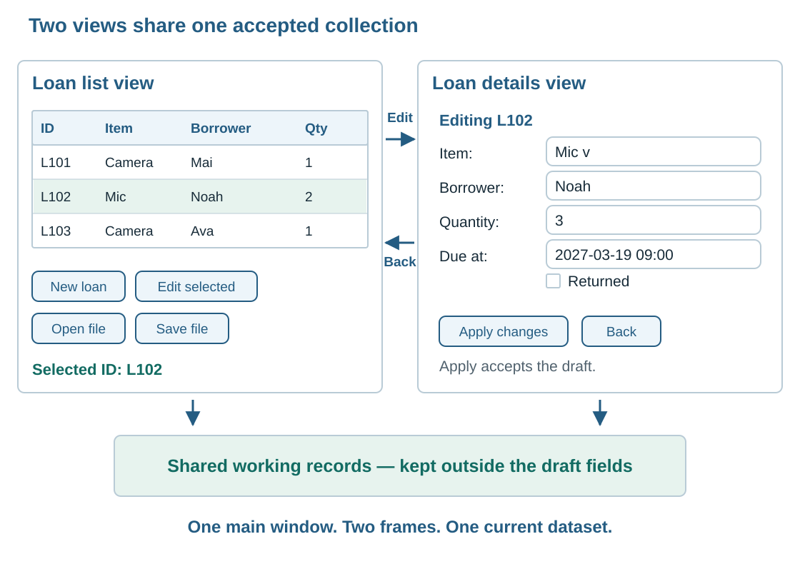

*Figure 12. The views are drawn side by side for comparison; the running application shows one at a time. The table still shows accepted quantity 2 while the draft contains 3.*

| View | Show and allow | State to keep |
|---|---|---|
| Loan list | Summary rows; New loan; Edit selected; Open file; Save file; current filename and saved/unsaved status. | Working records and selected ID. |
| Loan details | Loan ID or “New loan”; editable fields; read-only category/mass; Add loan or Apply changes; Back; nearby feedback. | A draft, its mode and its fixed target ID when editing. |

Use one main window containing two frames. A **frame** is a container grouping controls, such as all the fields and buttons belonging to the detail form. Show the required frame while keeping the shared records outside either view's temporary fields. The existing **event loop**, which waits for actions and runs their callbacks, continues running when you change frames. Navigation uses those existing frames and the running event loop.

With both frames placed in the same container area, Tkinter's `lift()` can bring one to the front. The navigation callback loads the appropriate record, prepares the fields and focus, and brings the frame to the front. [Tkinter widget stacking][layout]

Edit selected reads the selected ID, loads an edit draft and displays details. Successful Apply changes updates that record and returns to the list with the same ID selected. Successful Add loan returns with the new ID selected.

Back means return to the list. If nothing was changed, do so immediately. If the draft differs from the accepted record, ask whether to keep editing or discard the draft. Discarding must leave the accepted record unchanged.

After loading an existing record into the fields, keep a copy of those values as the draft's starting set. When Back is requested, compare the current draft with that starting set. A borrower field that started as Noah and still contains Noah is unchanged; Noah changed to Mai is an edit. The starting set gives the program a precise reference for deciding whether the draft has changed.

| Leaving action | Changes that need a decision | Choices and effect |
|---|---|---|
| Back from changed details | Changes in the current draft. | Keep editing, or Discard edits and return. |
| Open file from the list | Accepted records changed since the last successful save. | Save file, Discard changes, or Cancel the Open request. |
| Close the application | Unapplied draft, then any unsaved accepted records. | Keep editing to stop closing, or Discard edits to drop the draft. Then offer Save file, Discard changes or Cancel if accepted records are unsaved. |

If Save file is chosen before Open or Close, a successful save allows the requested action to continue. Cancelling the save dialog or encountering a write error returns the user to the current work and finishes that request. A later Open or Close click begins a fresh request.

Discarding accepted changes before Open means permitting replacement when a valid new file is ready. Keep the old collection until then; cancelling Open or rejecting its file returns to that collection.

Before changing the layout, draw a **mock-up**: a picture of the screen you intend to build. Add **annotations**, short notes explaining the actions, data and feedback associated with the drawing. For these two views, your notes should identify:

- Which controls supply input and which values are read-only.
- Which action changes a working record and which writes a file.
- The destination of New loan, Edit selected and Back.
- The initial selection, disabled controls and where feedback appears.
- What happens to a changed draft when the user leaves.

For example, beside Edit selected, write: “Enabled after a loan is selected. Opens that loan's draft.” Beside Save file, write: “Writes the accepted working collection to the chosen file.” These notes can be checked against the working application.

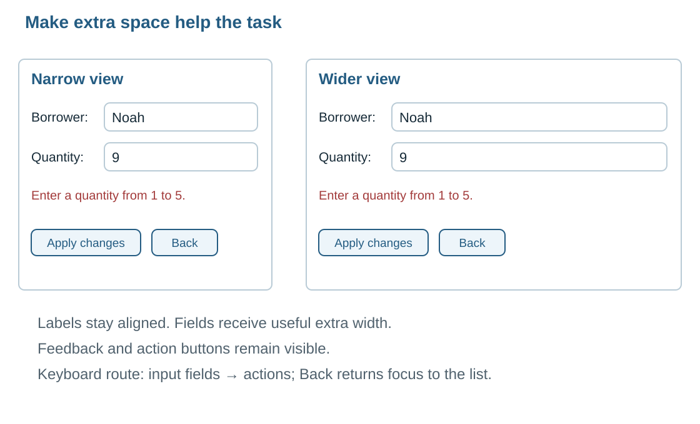

*Figure 13. Extra width should help the working area. Labels stay beside their fields and the action buttons remain visible.*

Group the file/action buttons, record table, detail fields and feedback in suitable frames. A row of related action buttons is often called a **toolbar**. Inside a frame, a **grid** arranges controls in rows and columns. **Padding** is the space around controls; it keeps a field or button from touching its neighbours.

Keep labels aligned and give extra width to the fields and table. For example, making the window wider should give a long borrower name more room, while keeping the label beside the field. The `sticky` setting controls where a widget sits inside its grid cell and whether it stretches towards the cell's edges. Row and column **weights** decide how extra space is shared between cells. Give the field's column a share of the extra width so the field can stretch into it.

When a frame contains its own grid, the layout is **nested**: one arrangement sits inside another. The inner field, its frame and the window's grid must all allow the intended growth. Assign space through each container so extra window width reaches the inner fields. [Grid resizing][grid]

Keep field labels visible: placeholder text disappears when typing starts. Label units and formats, such as `Mass per item (kg)` and `Due at (YYYY-MM-DD HH:MM)`. Use a text message to explain a failed check; use colour alongside the written instruction to draw attention to the relevant field.

On New loan, request focus for the first editable input. On Edit selected, focus the first field you need to change. Tab and Shift+Tab should move through the editable controls and actions in a useful order. Returning to the list should restore its selected record and move focus to the table.

Selection identifies the active record. Focus identifies the control receiving keyboard input. Check both when returning to the list: the row highlight should identify the accepted record, and the next arrow-key action should operate on the table.

### 3.2 Test a full workflow and investigate where it fails

A full workflow follows the values through several connected actions. After Add updates the collection and its table, Save should write that current collection. The sequence below checks the data passed between those actions.

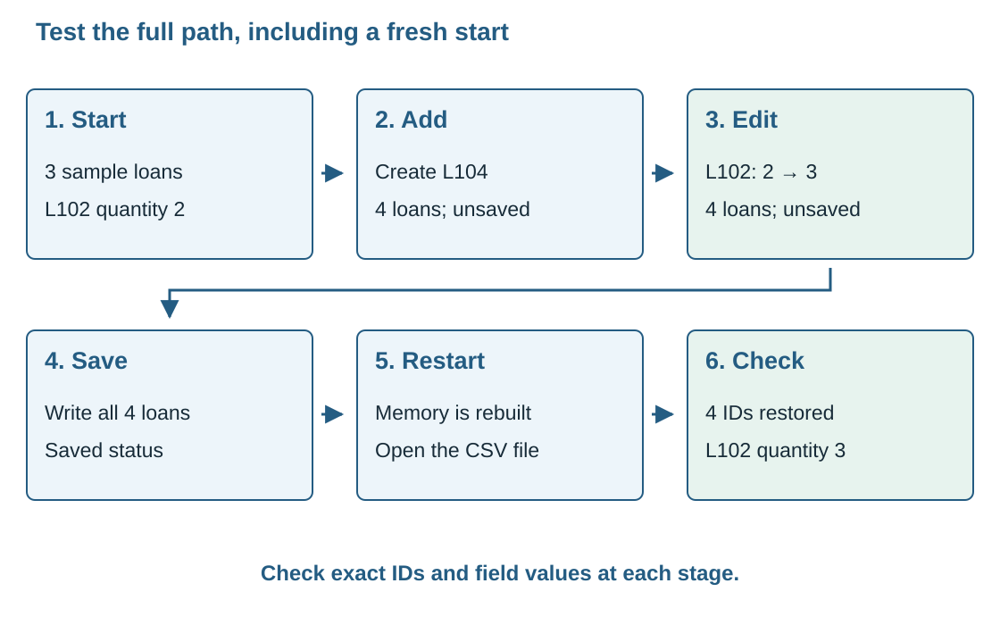

*Figure 14. Restart the application, open the saved file and inspect the records restored from storage.*

Start with a fresh copy of the three sample loans. Add L104 with Tripod, Linh, quantity 2 and due time `2027-03-20 12:00`. The catalogue gives V and 1.20 kg; Returned is false. Then edit L102 quantity from 2 to 3.

| Checkpoint | Expected working records | Expected GUI/file state |
|---|---|---|
| Before Add | L101, L102, L103. | Three rows. |
| After Add | Four IDs, including L104 with quantity 2. | Four rows; L104 selected; unsaved indicator. |
| After editing L102 | Four records; only L102's quantity changes to 3. | L102 selected and showing 3; still unsaved. |
| After Save file succeeds | Same four records. | Current filename shown; saved indicator. |
| After restart and Open | Same four IDs and all field meanings recovered from the file. | Four rows; previous selection cleared; data marked saved. |

Write expected results before execution. Record actual values separately. Record specific values such as `L102 quantity=3; row quantity=3; four records; L101 unchanged`.

| Sequence | Expected outcome |
|---|---|
| Edit L102 quantity to 9; Apply changes. | Error shown; accepted L102 and its row remain unchanged; draft retains 9. |
| Start editing L102; change borrower; Back; Keep editing. | Same changed draft and target ID remain visible. |
| Repeat and choose Discard edits. | Return to the list; accepted borrower is unchanged; L102 remains selected. |
| Make an accepted edit; request Open; choose Save file; cancel its save dialog. | Control returns to the list with the accepted edit marked unsaved. |
| From four valid records, open a malformed file. | Error; all four old records, their display and current path remain intact. |
| Apply a valid edit twice using the same values. | The record count and accepted values stay the same. |
| Complete Add and immediately activate the same action again. | The record count stays at its value after the successful Add. |

If a test fails, record the exact action sequence that caused it. Include the selected ID, entered values and last completed action so another developer can repeat the sequence.

Follow the callback from its starting values through record lookup, validation, update and display refresh. Each stage gives you a specific checkpoint to inspect.

Suppose a test starts with L102 selected and ends with L101's quantity changed to 3. Follow the selected ID through the callback to locate the cause:

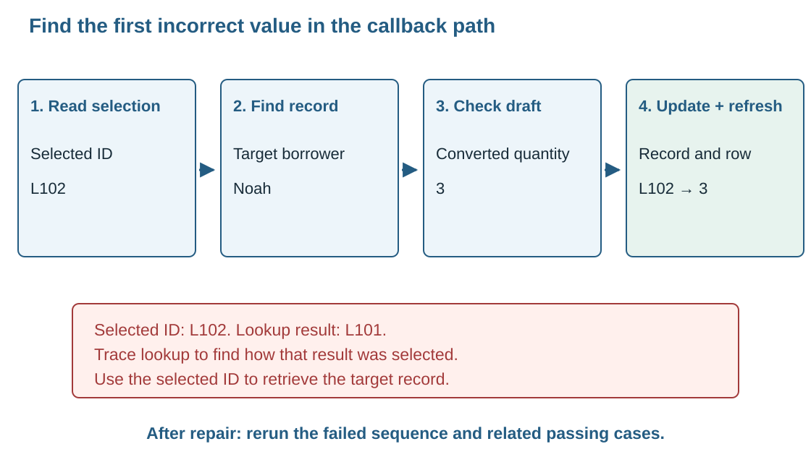

*Figure 15. Stop where an important value crosses from one stage to another.*

| Checkpoint | Inspect | Expected value for this test |
|---|---|---|
| Edit selected begins | Selected internal ID. | `L102` |
| Record lookup finishes | Target record ID and borrower. | `L102`, Noah. |
| Apply changes begins | Fixed edit target and draft quantity. | `L102`, text `"3"`. |
| Validation finishes | Converted quantity and target ID. | Integer `3`, `L102`. |
| Working data updated | L102 and L101. | L102 quantity 3; L101 quantity 1. |
| Table refreshed | Updated row ID and visible quantity. | L102 shows 3. |

A **debugger** is a tool that lets you pause a running program and inspect its values. A **breakpoint** marks an instruction where the debugger should pause. **Stepping** then runs the next instruction while you watch what changes. Use these tools to find the first checkpoint that differs from the expected trace. A later wrong screen value can be caused by an earlier wrong ID.

**Diagnostic output** is temporary information written to help you inspect the running program. It can record the same checkpoints in a console or log, for example: `Edit target=L102; raw quantity='3'; accepted quantity=3`. Label the selected ID, draft text and converted number so you can identify each value in the trace. Inspecting these messages helps you compare what actually happened with your expected trace. Remove temporary output when the fault is understood.

For an input trace, remember that the callback can run while another action writes fields. If simply opening an edit form marks it changed, inspect the field-loading stage and draft-change comparison before changing the Back button.

After correcting the faulty connection, rerun the exact failed sequence and the related passing tests: another selected record, invalid quantity, repeated Apply, and return to the list. This is a **regression check**: it confirms that previously working behaviour still produces its expected results after the correction.

The next step is to classify what went wrong so you can repair the cause. A **syntax error** occurs when Python identifies a problem in the code's grammar, such as a missing colon. A **runtime error** occurs while instructions are being executed. A **logic error** produces behaviour that breaks a required rule during execution.

An **exception** is an error reported by Python during execution. Its name, such as `TypeError`, helps identify the kind of failure. Inspect error information, stored values and the visible result together to locate faults such as an incorrect record update.

| Fault | Concrete example | What it tells you to inspect |
|---|---|---|
| Syntax error | A callback definition is missing its colon, causing Python to report a syntax error. | The reported syntax location before trying GUI actions. |
| Logic error | Apply changes updates L101 while L102 was selected; the program keeps running. | ID mapping, edit target and the record update. |
| Runtime type mismatch | An instruction attempts `"3" + 2`, combining a string and integer; Python raises `TypeError`. | The value's type and conversion boundary. |
| Runtime index out of range | Code reads the first position of an empty Listbox selection and raises `IndexError`. | The check for an empty selection; Python sequence access can raise `IndexError`. |
| Runtime divide by zero | An average calculation divides by the number of loans when that number is zero. | The zero-record path before division; Python raises `ZeroDivisionError`. |
| Failed value conversion | Converting `"nine"` to an integer raises `ValueError`. | The attempted conversion and the message asking for a whole number. |
| Numeric overflow in a bounded representation | An unsigned 8-bit field has capacity for values 0–255. Storing 256 exceeds that capacity. | The capacity of the chosen numeric representation. |

In that overflow example, **8-bit** means eight binary digits, each holding 0 or 1. Together they allow 256 different patterns. **Unsigned** means the representation is used for zero and positive integers, giving values 0–255. The value 256 therefore needs more capacity than that field provides.

Python integers can grow beyond fixed 8-bit limits, subject to available resources. A normal Python integer therefore holds 256 directly. In our quantity field, entering 6 triggers the **range-rule check**, which asks for a value from 1 to 5. [Python exception types][exceptions] [Python integer representation][types]

Explain a repair through its cause and corrected behaviour. For example, using the selected record ID during lookup directs the edit to L102 and makes its row show the accepted quantity. Validation messages guide the user's corrections, and diagnostic traces help you investigate faults in the program.

### 3.3 Apply the ideas to a new booking interface

We will now apply the same GUI principles to a **school workshop booking register** with two views. Use the rules and mock-up below to make your own interface. Use a stable ID, separate draft values, validation before acceptance and a display refreshed from accepted records for this application.

In the booking form, Student name identifies the participant, Workshop records the chosen activity, and Places holds the number of places requested. Session records Morning or Afternoon. Use your knowledge of text fields, dropdowns and radio groups to connect each field to its value and required checks.

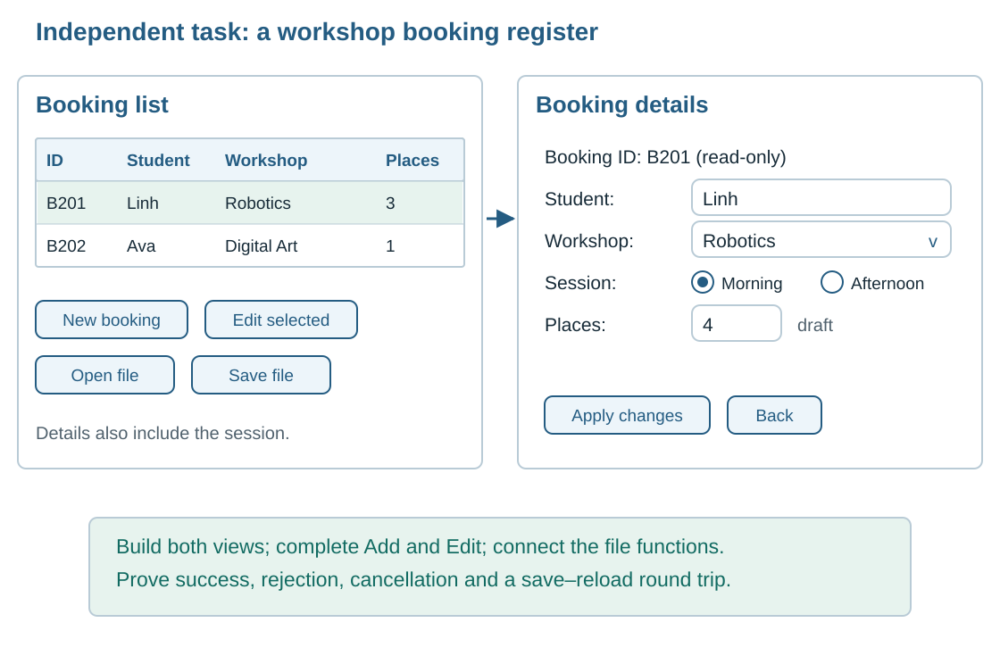

*Figure 16. The context and fields change; stable identity, draft checking, navigation and file actions still apply.*

| Field | Rule and starting value | Control |
|---|---|---|
| Booking ID | Unique string, generated when a new booking is accepted; fixed on edit. | Read-only label. |
| Student name | Required non-space text; initially empty for New booking. | Text field. |
| Workshop | Robotics or Digital Art; initially empty. | Selection-only dropdown. |
| Session | Morning or Afternoon; initially Morning. | Radio-button group. |
| Places | Integer 1–5 inclusive; initially empty. | Text field. |

For this application, the places rule is simply 1–5 for each booking. The register stores the booking ID, student, workshop, session and places.

Use this starting file data:

| Booking ID | Student | Workshop | Session | Places |
|---|---|---|---|---|
| B201 | Linh | Robotics | Morning | 3 |
| B202 | Ava | Digital Art | Afternoon | 1 |

The list view shows ID, student, workshop and places, plus New booking, Edit selected, Open file and Save file. The detail view also shows the session and contains the draft, Add booking or Apply changes, Back and feedback. Keep file actions on the list view.

| Action | Required processing | Required final display |
|---|---|---|
| Add booking | Read the draft; validate every field; obtain an unused ID; add one accepted record. | Return to the list with the new booking selected; mark data unsaved. |
| Edit booking | Find the selected ID; load a separate draft; validate; update that same ID. | Return with that ID selected and revised fields visible, keeping the current record count. |

On rejection, keep the draft for correction and preserve the accepted records. Back with changes offers Keep editing or Discard edits. A complete, valid file is ready to replace the working collection through Open. Cancelling a dialog returns to the current work.

Connect your booking reader and writer to Open file and Save file using the file-function contracts from Part 2. Use the booking fields shown above as their file structure. The reader must check the workshop, session and places rules before returning accepted data; the GUI then handles replacement, table refresh and feedback.

Follow B201 through a complete edit before testing the other cases. Selecting its row identifies B201 and loads Linh's values into a draft. Changing places from 3 to 4 leaves the accepted record at 3 while you are still typing. Apply changes checks the draft, updates B201 and returns to a list showing 4. Save file then writes the accepted 4 to storage. Reopening the file is the final check that the accepted edit was preserved.

Use these specific cases to check your implementation:

1. Add a Robotics, Morning booking for student Sam with 2 places. Using the next unused number after B201 and B202 gives B203. Check that exactly one new row appears.
2. Edit B201 places from 3 to 4. Check B202 and B203 are unchanged.
3. Enter 0 places during an edit. Check that rejection preserves the accepted booking and leaves the draft available.
4. Start an edit and use Back with both Keep editing and Discard edits. Check selection and stored values each time.
5. Save, restart and Open. Check that B201 still has 4 places and all three IDs remain.
6. Cancel a file dialog and try a malformed file. Check that valid current records are retained.

When explaining your result, follow one action from the screen to the data and back: **input or selection → draft and target ID → validation → accepted record → refreshed view**. Add the file-reading or file-writing stage when Open or Save is requested. You should be able to identify the exact stage at which an invalid value, a cancelled action or a wrong ID stops the intended workflow.

**Technical references**

The worked applications and behaviour rules in this guide are teaching examples. The technical references below explain the underlying Tkinter and Python mechanisms.

- [TkDocs — basic controls and linked values][widgets]
- [TkDocs — StringVar reading, writing and notifications][stringvar]
- [Python — Combobox and Treeview options and operations][ttk]
- [TkDocs — Treeview record display and identifiers][tree]
- [TkDocs — grid layout and resizing][grid]
- [TkDocs — window and sibling-widget stacking][layout]
- [Python — native file dialogs and cancellation][dialogs]
- [Python — CSV reading, writing and field conversion][csv]
- [Python — exception types][exceptions]
- [Python — built-in numeric types][types]

[widgets]: https://tkdocs.com/tutorial/widgets.html
[stringvar]: https://tkdocs.com/pyref/stringvar.html
[combobox]: https://docs.python.org/3/library/tkinter.ttk.html#combobox
[ttk]: https://docs.python.org/3/library/tkinter.ttk.html
[tree]: https://tkdocs.com/tutorial/tree.html
[grid]: https://tkdocs.com/tutorial/grid.html
[layout]: https://tkdocs.com/tutorial/windows.html
[dialogs]: https://docs.python.org/3/library/dialog.html
[csv]: https://docs.python.org/3/library/csv.html
[exceptions]: https://docs.python.org/3/library/exceptions.html
[types]: https://docs.python.org/3/library/stdtypes.html#numeric-types-int-float-complex
